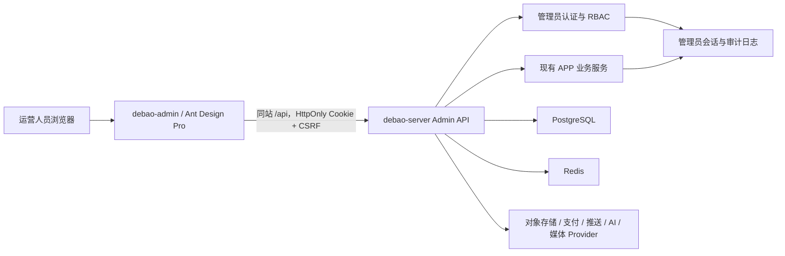

# 得宝运营后台详细设计

更新时间：2026-09-14  
状态：后台 Goal 核心闭环已完成（ADMIN-00 至 ADMIN-09 的本机页面、真实 API、权限与回归验收均已完成）；生产独立队列、告警、正式 Provider 回执和部署演练待外部环境  
后台工程：`debao-admin`  
服务端：复用并扩展 `debao-server`

## 1. 产品定位

得宝运营后台用于管理 APP 的用户、学习内容、课程、交易、社区、运营触达、AI 配额和系统权限。它是独立 Web 管理端，不替代移动端，也不得改变已经完成的移动端 Figma 正常态。

首期采用“完整业务骨架 + 内容运营和社区治理重点完成”的策略：所有核心业务有真实菜单、权限和查询入口；题库、法条、课程、论坛、公告做到可实际维护；AI 深度分析、复杂财务对账和高级增长分析可在第二阶段增强。

不允许把后台做成只有静态数据的演示页。列表、详情、写操作、权限、审计、错误态和数据库必须形成真实闭环。

## 2. 固定技术选型

| 层级 | 选型 | 用途 |
|---|---|---|
| 后台框架 | Ant Design Pro | 现成后台工程能力和页面范式 |
| 应用框架 | Umi Max + React + TypeScript | 路由、布局、权限、请求和构建 |
| UI | Ant Design 5 + Pro Components | ProLayout、ProTable、ProForm、详情和统计组件 |
| 状态 | Umi Initial State/Model + `useRequest` | 登录态、权限和页面请求；不重复引入第二套服务端状态框架 |
| API 类型 | OpenAPI + `openapi-typescript` | 从 `debao-server/openapi.yaml` 生成类型 |
| 图表 | ECharts | 趋势、漏斗、科目和交易图表 |
| 富文本 | Tiptap | 公告、课程说明和运营内容；题目与法条使用结构化字段 |
| 测试 | Vitest + Testing Library + Playwright | 单元、页面交互和管理流程 E2E |
| 包管理/运行时 | pnpm + Node.js 22 LTS | 与项目 TypeScript 工具链保持一致 |

工程路径固定为：

```text
E:\code\得宝APP开发\debao-admin
```

不采用 Next.js、React Admin、若依或 Vue 管理模板。后台不需要 SSR；React Admin 对复杂题目、课程树和审核流限制较多；若依和 Vue 模板会引入与现有项目冲突的第二套体系。

## 3. 系统架构



部署时由反向代理将后台页面和 `/api` 放在同一站点。管理员会话使用 `HttpOnly + Secure + SameSite=Lax` Cookie；写请求携带 CSRF Token。不得把正式管理令牌放在 `localStorage`，不得继续使用当前硬编码的 `admin-token`。

## 4. 导航与菜单树

后台采用 10 个一级菜单。菜单按权限动态生成，没有权限的入口不显示，服务端仍必须再次鉴权。

```text
工作台
用户与权益
内容中心
课程与学习
商城交易
社区治理
运营中心
AI 运营
数据分析
系统管理
```

### 4.1 工作台

路由：`/dashboard`

页面区域：

- 今日核心指标：新增用户、活跃用户、答题人数、付费金额、退款金额、论坛新增内容。
- 待办队列：待审核题目、待处理举报、待批改、待退款、待发布公告、Provider 异常。
- 业务趋势：近 7/30 天注册、学习、订单和收入趋势。
- 系统健康：API、PostgreSQL、Redis、短信、支付、推送、AI、媒体服务状态。
- 快捷入口：新建题目、新建课程、发布公告、处理举报。

规则：指标必须标明统计时间和时区；环比没有基线时显示“暂无对比”，不能显示伪造百分比。工作台只显示摘要，点击后进入对应带筛选条件的列表。

### 4.2 用户与权益

#### 用户列表 `/users`

筛选：用户 ID、昵称、脱敏手机号、考试年份、注册方式、注册时间、账号状态、是否付费、课程权益。

列：用户、脱敏手机号、考试阶段、注册方式、学习天数、已购课程数、最近活跃、账号状态、注册时间。

操作：查看详情、限制登录、解除限制、发放/撤销人工权益。默认禁止物理删除用户。

#### 用户详情 `/users/:id`

使用独立详情页，分为：

- 基础资料：昵称、头像、脱敏手机号、考试年份、注册时间。
- 身份安全：微信绑定状态、设备、活跃会话、换绑记录、注销状态。
- 学习数据：答题、错题、收藏、计划、课程进度、学习时长。
- 交易权益：订单、课程权益、批改次数、人工调整记录。
- 社区行为：帖子、评论、举报、被处理记录。
- 操作历史：所有管理员对该用户执行的动作。

查看完整手机号必须具备 `users.pii.reveal` 权限，填写查看原因并写入审计。限制登录、强制下线、撤销权益必须二次确认。

#### 权益调整 `/entitlements/adjustments`

支持发放或撤销课程权益、批改次数和 AI 配额。必须填写原因、来源单号和有效期；重复请求使用幂等键；已支付订单生成的权益不得无记录直接删除。

### 4.3 内容中心

#### 科目与章节 `/content/subjects`

左侧科目树，右侧章节表。字段：名称、编码、排序、题量、状态。编码发布后不可随意修改；删除前检查题目、课程和法条关联。

#### 题目管理 `/content/questions`

筛选：题目 ID、关键词、科目、章节、年份、卷别、题型、难度、状态、来源、更新时间。

列：题干摘要、科目/章节、题型、年份、难度、版本、状态、引用次数、更新人、更新时间。

操作：新建、编辑草稿、复制、预览、提交审核、发布、停用、归档、批量导入、导出。

题目编辑页字段：

- 基础：科目、章节、年份、卷别、题型、难度、标签、来源。
- 内容：题干、材料、小问、选项。
- 答案：正确选项或参考答案、评分要点、解析、关联法条。
- 版本：版本号、变更说明、生效时间。
- 预览：客观题和主观题移动端效果。

发布后的题目不可覆盖历史版本。编辑发布题目必须产生新版本，历史答题报告继续引用提交时版本。

#### 试卷管理 `/content/papers`

支持历年真题、模拟卷、章节练习模板。字段：名称、年份、卷别、模式、时长、总分、题量、状态。组卷页面支持搜索添加、拖动排序、分值配置和总分校验。

#### 题库批量导入 `/content/imports`

客观题与主观题分流导入。支持 Excel、CSV、JSON 文件上传和对应模板下载；上传后自动识别表头，管理员确认字段映射并选择科目、章节、考点，再执行服务端预检。预检展示可导入数、重复跳过数和逐行错误，确认后题目以草稿状态写入对应题库，不自动发布。

#### 法条管理 `/content/laws`

筛选：法律名称、文号、条号、效力状态、生效日期、版本。

字段：法律名称、文号、条号、标题、正文、发布机关、公布/生效/失效日期、来源 URL、版本、关联题目。

操作：新建版本、预览、发布、设为失效、重建搜索索引。历史版本不可物理删除。

### 4.4 课程与学习

#### 课程管理 `/courses`

筛选：名称、教师、类型、状态、是否试看、上架时间。

列：封面、课程名、教师、类型、课时、学习人数、完成率、状态、更新时间。

状态：`draft -> scheduled -> published -> offline -> archived`。

课程编辑使用独立页面：基本信息、封面、教师、权益规则、有效期、试看设置、章节课时树、讲义、字幕、上架时间。章节和课时支持排序，但已产生学习记录的课时不得直接删除。

#### 直播排期 `/courses/live-sessions`

字段：课程、场次、教师、开始/结束时间、Provider 房间 ID、预约人数、直播状态、回放状态。操作包括创建、改期、取消、补发通知和查看异常；改期/取消必须通知已预约用户。

#### 学习记录 `/learning/records`

按用户、课程、科目、日期和事件类型查询答题/播放/任务事件。原始事件只读；异常修正使用补偿记录，不直接改历史事件。

#### 学习计划 `/learning/plans`

查看用户计划、任务完成率、逾期情况和跨设备更新时间。首期只读和异常诊断，人工修改需具备单独权限并记录原因。

#### 批改管理 `/grading`

批改管理必须区分运营主管视角和兼职老师工作台。运营端筛选：提交 ID、题目版本、用户、科目、AI 状态、人工状态、提交时间、批改人员、SLA 和申诉状态。

运营端详情展示题目批改依据、采分点、答案快照、AI 结构化结果、人工复核版本和完整事件时间线。操作包括分派、改派、升级主管、抽检、处理退回/申诉和发布报告。

兼职老师通过独立登录入口领取任务并提交人工评分，不能查看 AI provider、模型密钥、完整提示词、成本或未授权用户资料。状态遵循 `submitted -> ai_queued -> ai_processing -> ai_completed -> manual_queued -> manual_claimed -> manual_submitted -> supervisor_review -> published`，异常状态和幂等约束见 [GRADING_SYSTEM_DESIGN.md](GRADING_SYSTEM_DESIGN.md)。

旧版“领取后直接填分”的字段和流程仅作为迁移兼容，不再作为新业务契约；统一使用 [GRADING_SYSTEM_DESIGN.md](GRADING_SYSTEM_DESIGN.md) 中的题目版本、AI 首轮、人工复核、报告发布和审计模型。

### 4.5 商城交易

#### 商品管理 `/commerce/products`

字段：商品名、分类、封面、SKU、价格、原价、库存策略、关联课程权益、有效期、销售状态、上架时间。

状态：`draft -> on_sale -> off_sale -> archived`。已成交商品修改价格必须产生新价格记录，不回写历史订单金额。

#### 订单管理 `/commerce/orders`

筛选：订单号、用户、商品、平台、支付渠道、订单状态、时间和金额范围。

列：订单号、用户、商品/SKU、应付/实付、渠道、状态、权益状态、创建/支付时间。

订单详情包含状态时间线、支付交易、回调、权益、退款和审计。订单金额和支付状态默认只读，禁止管理员直接编辑成“已支付”。

#### 退款售后 `/commerce/refunds`

流程：用户/客服申请 -> 审核 -> Provider 退款 -> 权益回收 -> 完成/失败。退款需填写原因；达到配置金额时启用双人复核。失败可重试，但不得重复退款。

#### 权益记录 `/commerce/entitlements`

查看订单、人工发放、恢复购买产生的权益及有效期。撤销必须检查学习进度、退款状态和来源。

### 4.6 社区治理

#### 帖子管理 `/community/posts`

筛选：帖子 ID、作者、关键词、分类、状态、是否被举报、发布时间。

列：标题、作者、分类、点赞、评论、举报数、状态、发布时间。

操作：查看详情、隐藏、恢复、删除、限制作者发言。原帖子正常发布时不需要后台预审；命中规则或举报后进入治理队列。

#### 评论管理 `/community/comments`

筛选和操作与帖子一致，必须显示上级帖子上下文，避免脱离语境处理评论。

#### 举报审核 `/community/reports`

状态：`pending -> processing -> resolved/rejected`。

审核工作台同时展示被举报内容、上下文、作者历史、举报理由和相似举报。处理结果：无违规、隐藏内容、删除内容、警告用户、限时禁言、永久封禁。每次处理必须填写依据，通知举报人和被处理用户时使用可配置模板。

#### 社区规则 `/community/rules`

管理分类、敏感词、频控和处罚阶梯。规则修改需要版本号和生效时间，避免无法解释历史处理结果。

### 4.7 运营中心

#### Banner `/operations/banners`

字段：标题、图片、投放位置、平台、目标人群、跳转类型/目标、开始/结束时间、优先级、状态。必须提供移动端比例预览并校验跳转参数。

#### 公告 `/operations/announcements`

状态：`draft -> scheduled -> published -> expired/withdrawn`。支持富文本、置顶、目标人群、已读统计和深链。撤回已发布公告必须填写原因。

#### 消息模板 `/operations/templates`

按账号安全、订单、课程、直播、学习提醒、批改结果分类。变量必须声明类型并提供测试预览，禁止未声明变量直接发布。

#### 推送任务 `/operations/push-jobs`

流程：创建草稿、选择人群、预估人数、测试发送、定时发送、暂停/取消、查看送达/点击/失败。真实 Provider 未配置时按钮明确禁用，不伪造成功。

### 4.8 AI 运营

#### 配额管理 `/ai/quotas`

按用户等级配置日/月次数、Token 上限和并发数；人工调整写入原因和有效期。

#### Provider 状态 `/ai/providers`

显示配置状态、可用性、延迟、错误率、成本和熔断状态。只显示密钥是否配置，不回显密钥。

#### 风险记录 `/ai/flags`

只展示被安全策略标记的消息和必要上下文。普通管理员不得任意浏览全部用户对话；查看敏感内容需要专门权限和审计。

#### 成本统计 `/ai/usage`

按日期、模型、功能、用户等级聚合请求量、Token、失败率和成本。

### 4.9 数据分析

子页面：用户增长、学习效果、课程表现、交易转化、社区健康、运营触达。

统一支持日期、平台、考试阶段等筛选，显示指标定义、更新时间和数据口径。图表不能只靠颜色表达状态；导出任务异步生成并记录下载人。

首期只做已有事实数据可以计算的指标，不使用静态随机数填充图表。

### 4.10 系统管理

#### 管理员 `/system/admins`

创建、停用、重置 MFA、强制下线、分配角色。超级管理员不能删除自己或停用最后一个超级管理员。

#### 角色权限 `/system/roles`

权限使用稳定代码，例如：

```text
users.read
users.pii.reveal
users.sessions.revoke
content.questions.write
content.questions.publish
courses.write
orders.read
orders.refund.approve
community.moderate
operations.publish
ai.flags.read
system.admins.manage
audit.read
```

角色保存时展示新增和移除的权限差异。前端菜单、页面操作和服务端接口使用同一权限代码。

#### 审计日志 `/system/audit-logs`

记录管理员、角色、动作、资源类型/ID、请求 ID、变更前后摘要、原因、IP、User-Agent、时间和结果。审计日志只允许查询和归档，不能在后台删除或编辑。

#### 系统配置 `/system/settings`

配置考试年份、频控、退款复核阈值、内容规则和功能开关。密钥类配置只允许通过部署环境或密钥管理系统维护。

#### 服务状态 `/system/health`

查看 API、数据库、Redis、迁移版本、队列和 Provider 状态。页面不得展示连接字符串或密钥。

## 5. 角色权限矩阵

| 模块 | 超管 | 内容编辑 | 教学运营 | 社区审核 | 客服 | 财务 | 数据观察 |
|---|---|---|---|---|---|---|---|
| 工作台 | 全部 | 摘要 | 摘要 | 社区摘要 | 用户/订单摘要 | 交易摘要 | 只读 |
| 用户资料 | 全部 | 只读基础 | 只读学习 | 只读社区 | 查询/有限处置 | 只读交易相关 | 聚合数据 |
| 完整手机号 | 可授权查看 | 无 | 无 | 无 | 按需查看 | 按需查看 | 无 |
| 题库/法条 | 全部 | 编辑/发布 | 只读 | 无 | 无 | 无 | 只读 |
| 课程/学习 | 全部 | 课程内容编辑 | 编辑/运营 | 无 | 只读 | 无 | 只读 |
| 批改 | 全部 | 题目批改依据/采分点 | 分派/抽检/发布 | 无 | 查询 | 无 | 统计只读 |
| 商品 | 全部 | 内容编辑 | 只读 | 无 | 只读 | 只读 | 只读 |
| 订单/退款 | 全部 | 无 | 无 | 无 | 查询/发起售后 | 审核/退款 | 只读 |
| 社区 | 全部 | 只读 | 无 | 审核/处罚 | 查询 | 无 | 只读 |
| 公告/Banner/推送 | 全部 | 编辑 | 编辑 | 无 | 只读 | 无 | 只读 |
| AI | 全部 | 无 | 配额只读 | 风险审核 | 用户额度查询 | 成本只读 | 只读 |
| 系统/审计 | 全部 | 无 | 无 | 无 | 无 | 审计只读 | 审计只读 |

角色是权限集合，不在业务代码里写死角色名称。初始只有一个人使用时仍建立 RBAC，避免以后扩团队时重做安全模型。

## 6. 通用页面与交互规范

- 桌面优先，设计基准 1440px；最低支持 1024px。手机端允许查看和处理简单待办，不保证复杂题目/课程编辑。
- 左侧菜单展开宽 224px、折叠宽 64px；顶部栏约 56px；内容区使用 16-24px 间距。
- 使用浅色、低动效、高密度工作台风格。品牌操作色沿用 APP 的 `#4C4BEA`，成功、警告、错误使用独立语义色，不能用一组紫色表达全部状态。
- 列表页采用“页面标题 + 筛选区 + ProTable”；筛选条件同步 URL，返回列表时保持页码、排序和筛选。
- 轻量详情用右侧 Drawer；题目、课程、订单、举报等复杂任务使用独立页面。
- 批量选择后显示固定批量操作条；批量隐藏、下架、导出均展示影响数量。
- 写操作显示 loading 并禁止重复提交；成功有明确反馈；失败展示业务错误和 `requestId`。
- 删除、封禁、退款、下架、撤回、权限变更必须二次确认，必要时要求输入资源名称或原因。
- 状态不能只靠颜色，必须同时提供文本或图标。
- 表单使用可见标签、字段级错误和帮助文本，不用 placeholder 代替字段名。
- 所有页面覆盖 loading、empty、error、forbidden、offline、retry；无权限返回 403 页面，不伪装成空数据。
- 不使用大面积营销卡片、渐变背景、装饰性动画、超大标题、卡片嵌套卡片。

## 7. 管理端认证与安全

现有 `admin-token` 必须废弃，并实现独立管理员账号体系：

- 管理员和 APP 用户分表、分会话、分权限，不允许 APP Token 调用 Admin API。
- 密码使用 Argon2id 或同等级方案；首个超管通过一次性初始化命令创建，不在迁移中写默认密码。
- 支持 TOTP MFA；超级管理员、财务和具有完整手机号权限的账号强制启用。
- 连续登录失败触发限流和临时锁定；记录 IP、设备和 User-Agent。
- 空闲 30 分钟过期，最长会话 8 小时；修改密码、停用管理员或撤销设备后会话立即失效。
- 管理 Cookie 只走 HTTPS；写请求校验 CSRF；CORS 只允许配置的后台域名。
- PII 默认脱敏；导出文件有权限、原因、水印、有效期和下载审计。
- 退款、封禁、权限、人工权益、内容发布等高风险操作必须写审计日志。

## 8. 数据模型增量

后台基础至少增加：

```text
admin_users
admin_roles
admin_permissions
admin_user_roles
admin_role_permissions
admin_sessions
admin_login_events
admin_audit_logs
admin_export_jobs
admin_import_jobs
content_review_records
community_reports
community_moderation_actions
user_restrictions
entitlement_adjustments
refund_requests
notification_templates
push_jobs
```

具体字段通过新增迁移实现，迁移必须幂等。业务事实仍写入现有业务表；后台不能另建一份脱离 APP 的题库、订单或论坛数据。

## 9. Admin API 设计

Admin API 统一使用 `/v1/admin` 前缀：

```text
POST   /v1/admin/auth/login
POST   /v1/admin/auth/mfa/verify
POST   /v1/admin/auth/logout
GET    /v1/admin/me
GET    /v1/admin/navigation
GET    /v1/admin/dashboard

GET    /v1/admin/users
GET    /v1/admin/users/:id
POST   /v1/admin/users/:id/restrictions
POST   /v1/admin/users/:id/sessions/revoke
POST   /v1/admin/users/:id/entitlements/adjust

GET    /v1/admin/questions
POST   /v1/admin/questions
PATCH  /v1/admin/questions/:id
POST   /v1/admin/questions/:id/publish
POST   /v1/admin/content/imports

GET    /v1/admin/courses
POST   /v1/admin/courses
PATCH  /v1/admin/courses/:id
POST   /v1/admin/courses/:id/publish

GET    /v1/admin/products
GET    /v1/admin/orders
GET    /v1/admin/orders/:id
POST   /v1/admin/refunds/:id/approve

GET    /v1/admin/community/posts
POST   /v1/admin/community/posts/:id/hide
GET    /v1/admin/community/reports
POST   /v1/admin/community/reports/:id/resolve

GET    /v1/admin/announcements
POST   /v1/admin/announcements
POST   /v1/admin/announcements/:id/publish
GET    /v1/admin/audit-logs
```

所有列表统一支持 `page/pageSize` 或项目统一游标、排序和筛选。后台表格适合页码分页；高增长审计日志和事件流使用游标。所有响应继续使用 `{data, requestId}`，写接口支持 `Idempotency-Key`。

OpenAPI 必须为 Admin API 提供完整 schema，后台类型从契约生成，不手写重复 DTO。

## 10. 状态机和不可变约束

| 业务 | 状态机 | 关键约束 |
|---|---|---|
| 题目 | draft -> review -> published -> disabled -> archived | 发布后变更新版本，历史提交引用旧版本 |
| 课程 | draft -> scheduled -> published -> offline -> archived | 有学习记录的课时不可物理删除 |
| 商品 | draft -> on_sale -> off_sale -> archived | 历史订单金额和 SKU 快照不可回写 |
| 订单 | pending -> paid/closed -> refunding -> refunded | 管理员不能直接修改为 paid |
| 批改 | queued -> processing -> completed/rejected | 原子领取，完成后不可覆盖结果，只能生成复核记录 |
| 帖子/评论 | published -> hidden/deleted | 隐藏可恢复，删除保留审计和必要证据 |
| 举报 | pending -> processing -> resolved/rejected | 每次处理记录依据和操作者 |
| 公告 | draft -> scheduled -> published -> expired/withdrawn | 已发布内容修改生成修订记录 |
| 推送 | draft -> scheduled -> sending -> completed/failed/cancelled | 发送任务幂等，取消不撤回已送达消息 |
| 退款 | requested -> reviewing -> processing -> completed/failed/rejected | Provider 退款和权益回收可重试且不可重复执行 |

## 11. 开发工作包

### ADMIN-00 工程基础

- 创建 `debao-admin` Ant Design Pro/Umi Max 工程。
- 配置布局、主题、环境变量、请求封装、错误边界、403/404/500 页面。
- 配置 OpenAPI 类型生成、Lint、TypeScript、测试和 CI 命令。

### ADMIN-01 管理员认证、RBAC 和审计

- 完成管理员数据模型、初始化超管命令、登录/MFA/退出/会话。
- 完成权限资源、角色管理、动态菜单、前后端鉴权和审计日志。
- 替换并删除硬编码 `admin-token` 行为。

### ADMIN-02 工作台、用户与权益

- 完成真实指标、待办、系统健康。
- 完成用户列表/详情、设备会话、账号限制、权益调整和 PII 查看审计。

### ADMIN-03 题库与法条

- 完成科目章节、题目版本、试卷、导入预检、法条版本和关联题目。

### ADMIN-04 课程、学习和批改

- 完成课程/课时树、直播排期、学习诊断和批改队列。

### ADMIN-05 商城、订单和退款

- 完成商品/SKU、订单详情时间线、权益和退款审核。

### ADMIN-06 社区治理

- 完成帖子、评论、举报、处罚和治理规则；与已完成论坛数据共用事实表。

### ADMIN-07 运营中心

- 完成 Banner、公告、模板和推送任务；Provider 缺失时展示明确不可用状态。

### ADMIN-08 AI 与数据分析

- 完成配额、Provider 状态、风险记录、成本和基于真实数据的分析页面。

### ADMIN-09 全量验证和交付

- 完成单元、服务端权限测试、Playwright 核心流程、OpenAPI、迁移和文档。
- 验证 1024/1280/1440/1920 宽度、键盘导航、表格溢出和无障碍。

## 12. 测试与验收门槛

- 每个 Admin API 覆盖未登录 401、无权限 403、输入错误 422、资源不存在 404、重复操作、并发和审计。
- 至少两个管理员角色验证菜单、按钮和接口权限一致，直接调用接口不能越权。
- 高风险操作验证原因、二次确认、审计记录和会话身份。
- 导入验证成功、部分失败、全部失败、重复数据和大文件任务状态。
- Playwright 覆盖登录、用户查询、创建/发布题目、课程编辑、订单查询、举报处理、公告发布、角色授权和退出。
- 页面覆盖 loading、empty、error、forbidden、retry；API 失败不得展示假数据。
- 最终通过 `pnpm check`、服务端 `npm run check`、OpenAPI 解析、迁移验证、Playwright 和 `git diff --check`。

首期完成定义：ADMIN-00 至 ADMIN-07 全部完成，ADMIN-08 至少完成真实数据可支持的配额、Provider 健康和基础指标；任何外部 Provider 未配置项必须明确标为受阻，不能伪造成功。

## 13. Goal 模式提示词

确认本设计后，可将下面整段作为新的后台 Goal：

```text
完成“得宝运营后台”的设计与开发。工作目录为 E:\code\得宝APP开发；新建独立后台工程 debao-admin，服务端继续使用 debao-server，移动端位于 debao-mobile。持续执行直到当前环境内所有可完成代码、测试和文档真正结束，不要只输出方案。

唯一产品与验收基线是 debao-mobile/docs/ADMIN_CONSOLE_DESIGN.md。先完整阅读该文件、debao-mobile/docs/BUSINESS_DEVELOPMENT_PLAN.md、FEATURE_BACKLOG.md、API.md、PROGRESS.md、TESTING.md、FORUM.md，以及 debao-server/README.md、openapi.yaml 和现有 migrations。检查 git status，保留所有既有修改，不得 reset、checkout 或覆盖用户工作。

固定采用 Ant Design Pro + Umi Max + React + TypeScript + Ant Design 5 + Pro Components，包管理使用 pnpm，Node 使用 22 LTS。后台项目路径固定为 debao-admin。使用 Umi layout/access/request/initialState/model，不重复引入另一套服务端状态框架；Admin API 类型从 OpenAPI 生成。图表使用 ECharts，富文本使用 Tiptap，测试使用 Vitest/Testing Library/Playwright。

按 ADMIN-00 至 ADMIN-09 顺序推进，一次只允许一个工作包 in_progress。先实现工程基础，再实现管理员账号、MFA、RBAC、动态菜单、HttpOnly Cookie/CSRF、会话和审计。现有硬编码 admin-token 必须替换；APP 用户 Token 不能访问 Admin API。所有后台写接口必须有权限、输入校验、幂等、并发控制和审计。

后台正常态采用低动效、高密度工作型设计：左侧导航、顶部工具栏、筛选区、ProTable、详情 Drawer 和复杂编辑独立页。沿用 #4C4BEA 作为品牌操作色，但状态使用独立语义色；不使用营销式 Hero、大面积渐变、装饰性卡片或夸张字号。覆盖 loading、empty、error、forbidden、offline、disabled、retry 和重复提交状态，保证键盘可访问和 1024-1920px 响应式。

业务模块必须包括工作台、用户与权益、内容中心、课程与学习、商城交易、社区治理、运营中心、AI 运营、数据分析和系统管理。ADMIN-00 至 ADMIN-07 要形成可实际使用的闭环；ADMIN-08 只使用真实可计算数据，不用随机图表。题目发布后生成版本，订单不能由管理员直接改成已支付，退款/封禁/权益/发布/权限变更必须二次确认和审计，普通管理员不得浏览全部 AI 对话或完整手机号。

每个工作包同步完成数据库迁移、debao-server Admin API、OpenAPI、debao-admin 页面、权限、测试和文档。先跑定向测试，再跑全量检查。外部支付、推送、AI、媒体或对象存储资料缺失时完成 Provider 边界、禁用/错误状态和接入文档后继续，不得虚报真实联调。

最终必须运行后台 pnpm check、后台 Playwright、服务端 npm run check、OpenAPI YAML 解析、迁移验证、docker compose config、git diff --check，以及 UI 反模式检测。更新 ADMIN_CONSOLE_DESIGN.md 的实际状态、PROGRESS.md、API.md、TESTING.md 和 debao-server/README.md。只有 ADMIN-00 至 ADMIN-09 当前环境内可完成事项全部完成、所有检查通过、外部阻塞写清后，才结束 Goal。
```

## 14. 已确认和待确认事项

已确认：

- 使用 Ant Design Pro（Umi Max + Ant Design 5 + Pro Components）。
- 新建独立 `debao-admin`，复用 `debao-server`。
- 后台按完整业务平台设计，不只做论坛或内容管理。
- 移动端正常态不因后台建设而改版。

默认决策（用户未另行指定时按此执行）：

- 首期完整搭建十个一级菜单，重点完成内容、课程、交易、社区和运营闭环。
- 建立团队级 RBAC，即使首期只有一个管理员。
- 管理端通过同站 HttpOnly Cookie + CSRF 鉴权。
- 退款达到配置阈值后需要双人复核。
- 普通论坛内容先发布后治理，命中规则或被举报后进入审核。

后续可调整但不阻塞工程启动：品牌 Logo/后台正式名称、管理员 MFA 方式、退款复核阈值、社区处罚时长、数据报表口径和各 Provider 正式账号。
