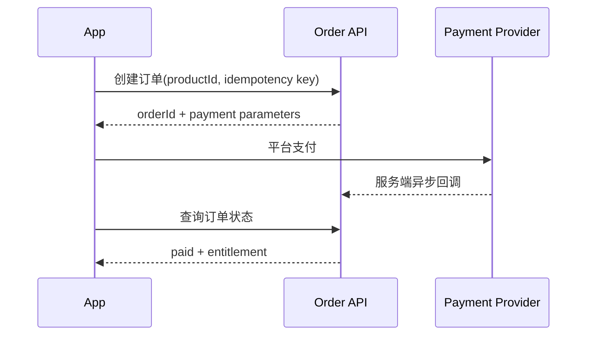

# Service 与 API 契约

客户端默认使用真实 API；设置 `DEBAO_USE_MOCKS=true` 只用于 Figma 原型演示。学习诊断在真实模式下通过统一 `ApiClient` 调用同级 `debao-server`，不会在网络失败时静默回退到 Mock 数据。

## 通用约定

建议真实 API 使用：

```ts
interface ApiEnvelope<T> {
  data: T;
  requestId: string;
}

interface ApiFailure {
  code: string;
  message: string;
  requestId: string;
  details?: Record<string, unknown>;
}
```

鉴权使用 `Authorization: Bearer <access-token>`。客户端不得保存支付私钥或 AI provider key。`ApiClient` 默认 12 秒超时，并把错误转换成 `ApiError(status, code)`。

## Application legal documents and user settings

`GET /v1/legal-documents/{key}` is a public read endpoint for the published,
versioned application documents used by the Settings and Account Security
screens. `key` is one of `terms`, `privacy`, `sdk-list` or `account-deletion`;
the response contains `key`, `title`, integer `version`, ISO `updatedAt`,
`status` and ordered `{title, body}` sections. Draft/disabled documents are
never returned to clients.

`GET /v1/me/settings` and `PATCH /v1/me/settings` are authenticated. They
return and update `learningReminders`, `courseUpdates` and
`orderNotifications`. The patch body must contain at least one boolean field.
Flutter uses these endpoints only in explicit remote mode and shows a retry
state when they fail; it does not replace a failed response with fixture
preferences.

## AuthService

状态：默认 Mock；设置 `DEBAO_USE_MOCKS=false` 后启用登录门禁，支持短信验证码、运营商一键登录、微信首次绑定手机号、会话恢复、资料和登出。三端供应商接入见 [AUTH_INTEGRATION.md](AUTH_INTEGRATION.md)。

| 方法 | 建议端点 | 说明 |
|---|---|---|
| `providers()` | `GET /auth/providers` | 查询服务端登录能力，不返回密钥 |
| `sendCode()` | `POST /auth/send-code` | 登录或绑定手机号验证码；携带设备 ID，服务端按用途、手机号、IP、设备频控 |
| `login()` | `POST /auth/login` | 短信验证码登录 |
| `oneClickLogin()` | `POST /auth/one-click` | 运营商 token 登录；可携带微信绑定票据 |
| `wechatLogin()` | `POST /auth/wechat` | 已绑定则登录，首次返回绑定票据 |
| `bindWechatPhone()` | `POST /auth/wechat/bind-phone` | 使用短信验证码完成微信绑定 |
| `getProfile()` | `GET /me` | 获取当前用户 |
| `updateProfile(profile)` | `PATCH /me` | 修改昵称、考试年份、头像颜色和已上传头像 URL |
| `identities()` | `GET /me/identities` | 查询当前账号的微信绑定状态 |
| `sendIdentityLinkCode()/bindWechatToCurrent()` | `POST /account/identity/link-code`、`POST /me/identities/wechat` | 当前手机号二次验证后绑定微信 |
| `sendIdentityUnlinkCode()/unbindWechat()` | `POST /account/identity/code`、`DELETE /me/identities/wechat` | 当前手机号二次验证后解绑微信 |
| `sendPhoneChangeCode()/phoneChange()` | `POST /account/phone/code`、`POST /account/phone/change` | 原号码和新号码双验证码换绑 |
| `deletionStatus()/requestDeletion()/cancelDeletion()` | `GET/POST /account/deletion`、`POST /account/deletion/cancel` | 7 天冷静期注销与撤销 |
| `refresh()` | `POST /auth/refresh` | 轮换 Refresh Token，旧 token 立即失效 |
| `logout()` | `POST /auth/logout` | 吊销 refresh token |

手机号必须由服务端脱敏。微信 `AppSecret`、运营商密钥和短信密钥只允许进入服务端环境变量；客户端只传递一次性授权凭证。

`DeviceService.list/remove` 对应 `GET /devices` 和 `DELETE /devices/:id`。列表返回 `current` 标识；移除设备会吊销该设备的全部会话，不能只删除展示记录。

## QuestionService

状态：默认 Mock；真实模式使用本地 API，草稿同时保留本地缓存以支持离线恢复。

```ts
interface QuestionSubmission {
  questionId: string;
  answers: string[];
}
```

| 方法 | 建议端点 | 说明 |
|---|---|---|
| `listSubjects()` | `GET /question-subjects` | 科目与题量 |
| `listQuestions(subjectId?)` | `GET /questions?subjectId=<id>` | 分页题目列表；传入科目时只返回该科目题目 |
| `saveDraft()` | `PUT /question-drafts/:id` | 跨设备草稿 |
| `submit()` | `POST /question-submissions` | 服务端生成 submissionId |
| `listRecords()` | `GET /question-records` | 当前用户答题记录 |
| `listMistakes()` | `GET /mistakes` | 未解决错题与题目内容 |
| `resolveMistake(id)` | `DELETE /mistakes/:id` | 标记错题已复习 |
| `listFavorites()` | `GET /favorites` | 当前用户收藏题目 |
| `addFavorite/removeFavorite()` | `POST/DELETE /favorites` | 收藏增删与幂等 |

正式答题接口必须由服务端校验题目版本，不能相信客户端分值或正确答案。

## GradingService

状态：客户端已接入题目版本、采分点、答案快照、幂等提交、AI 首轮、人工复核和报告实体的基础契约；附件上传、异步 Worker 和真实 Provider 仍按 [GRADING_SYSTEM_DESIGN.md](GRADING_SYSTEM_DESIGN.md) 保留为外部/生产化边界。

### 学员端

| 方法 | 端点 | 说明 |
|---|---|---|
| `listGradableQuestions()` | `GET /grading/questions` | 只返回后台已发布且启用批改的题目及剩余权益 |
| `getGradableQuestion(id)` | `GET /grading/questions/:id` | 返回题目版本、小问、允许附件和提交规则 |
| `submit()` | `POST /grading/submissions` | 提交不可变答案快照，必须携带 `Idempotency-Key` |
| `list()/get()` | `GET /grading/submissions`、`GET /grading/submissions/:id` | 查询本人状态和进度 |
| `report(id)` | `GET /grading/submissions/:id/report` | 仅 `published` 状态可读最终报告 |
| `appeal(id)` | `POST /grading/submissions/:id/appeals` | 生成独立申诉复核记录，不覆盖原报告 |

### 批改人员端

独立于普通用户和运营后台的登录域：`/grader/auth/*`、`/grader/tasks/*`、`/grader/stats`。批改人员只能看到授权任务和必要用户信息，不能读取 AI provider key、模型密钥、完整提示词或成本配置。

### 管理端

题目批改配置、采分点、任务分派、主管复核、报告发布和团队统计使用 `/admin/content/questions/:id/grading-rubric`、`/admin/grading/*`。AI provider 和 GPT 模型配置只允许系统管理员通过服务端管理接口操作，密钥不回传页面。

旧版 `submit({questionId?, fileUrl?})` 和 `queued -> processing -> completed` 仅用于兼容已有原型，不能作为正式批改闭环的验收标准。

## CourseService

状态：默认 Mock；真实模式使用本地 API。

| 方法 | 建议端点 | 说明 |
|---|---|---|
| `list()` | `GET /courses` | 当前用户课程 |
| `get(id)` | `GET /courses/:id` | 课程基础信息 |
| `entitlement(id)` | `GET /courses/:id/entitlement` | 当前用户课程权益 |
| `updateProgress(id, progress)` | `POST /courses/:id/progress` | 持久化学习进度 |

课程进度按用户存储，服务端不会更新全局课程记录。媒体 URL 应由服务端返回短时签名地址，并包含 DRM/清晰度/字幕元数据。

## OrderService 与 PaymentService

状态：默认 Mock；真实模式使用本地订单 API，支付由服务端适配器决定，当前 local 适配器不会产生真实扣款。

```ts
interface CreateOrderRequest {
  productId: string;
  clientRequestId: string;
}
```

建议流程：



客户端支付结果不能直接开通课程。服务端必须验签、幂等处理回调并发放权益。iOS 数字内容需先确认 App Store IAP 合规方案。

## Learning activities and attachments

The mobile data layer exposes `recordActivity()` and `activities()` for
`POST /learning/activities` and paginated `GET /learning/activities`.
Activity kinds are `question`, `course`, `task`, and `reading`; retryable
telemetry writes should include an `Idempotency-Key`.

### First learning diagnostic

The first learning diagnostic is a real, persisted learning-center flow rather
than a client-only questionnaire. `GET /learning/diagnostic` returns the
purchase access state, the published form configuration, active profile
dimensions, and published questions. `POST /learning/diagnostic/submit` accepts
`startedAt` and the answer list, validates every answer on the server, stores an
immutable question/answer snapshot, calculates profile scores, and creates the
class-stage-teacher assignment. Reopening `GET /learning/diagnostic` after
submission returns `completed: true`, the scores, and the assignment; a second
submission is rejected with `409 DIAGNOSTIC_ALREADY_COMPLETED`.

The learning-center admin uses `GET /admin/learning-diagnostic/results` to
review submitted users, profile scores, answer snapshots, and assignment status.
The admin can configure the form, dimensions, questions, and publish state
through the `/admin/learning-diagnostic/*` endpoints. Published questions hide
option scores from the App; scoring stays on the server.

Subjective grading uploads use `POST /attachments/preflight`, the returned
upload URL/token, and `POST /attachments/:id/complete`. Only completed,
unexpired uploads can be referenced by a grading submission. Supported types
are JPEG, PNG, and PDF up to 15 MiB.

Order status values include `pending`, `paid`, `closed`, `cancelled`,
`refund_requested`, and `refunded`. `POST /orders/:id/cancel` only accepts
pending orders; `POST /orders/:id/refund` creates a refund request; and
`GET /orders/:id/events` returns the immutable order timeline.

## AIService

状态：默认 Mock 流式文本；真实模式调用服务端 AI 适配器，正式 provider 仍需密钥和审核策略。

```ts
streamReply(prompt: string, onChunk: (chunk: string) => void): Promise<void>
```

建议真实端点为 `POST /ai/conversations/:id/messages`，响应 SSE 或 WebSocket 流。服务端负责模型密钥、内容审核、引用来源、限流和成本记录。客户端必须支持取消、重试和流中断恢复。

Conversation history is available through `POST/GET /ai/conversations`,
`GET/PATCH/DELETE /ai/conversations/:id`, and
`GET/POST /ai/conversations/:id/messages`. Message and conversation writes
accept `Idempotency-Key`; provider credentials remain server-side.

## MediaService

状态：默认 Mock；真实模式调用媒体授权适配器，当前未配置 CDN/DRM 时返回 `available: false`。

正式能力至少包含：播放授权、媒体 URL、直播房间 token、播放进度同步、离线清单、下载校验、DRM 和过期清理。

## NotificationService

状态：默认 Mock；真实模式调用服务端通知接口，三端系统权限仍需原生模块申请。

真实流程需区分 APNs、FCM/厂商通道和 Harmony Push。设备 token 只能提交给自有后端，后端记录平台、环境、用户和 token 更新时间。

| 方法 | 端点 | 说明 |
|---|---|---|
| `list()` | `GET /notifications` | 当前用户通知，返回 `read` 状态 |
| `markRead(id)` | `POST /notifications/:id/read` | 幂等写入当前用户已读回执 |
| `requestPermission()` | `POST /notifications/permission` | 三端原生权限申请结果 |

The notification service also supports a paginated `listPage()` call,
`readAll()`, and announcement detail/read/close operations:
`GET /notifications?cursor=&limit=&unreadOnly=`,
`POST /notifications/read-all`, and
`GET/POST /announcements/:id[/read|/close]`.

## ForumService

状态：核心业务闭环已实现。Mock 模式保持 Figma 原型 6 篇帖子；真实模式严格读取论坛 API，包含列表 loading/error/empty/retry 和游标加载更多，不回退到原型帖子。

| 方法 | 端点 | 说明 |
|---|---|---|
| `list()` | `GET /forum/posts` | `category`、`scope=all/mine/favorites`、`cursor`、`limit` |
| `get()/create()/remove()` | `GET/DELETE /forum/posts/:id`、`POST /forum/posts` | 详情、发布和作者软删除 |
| `toggleLike()` | `POST /forum/posts/:id/like` | 当前用户点赞/取消，唯一约束防重复记录 |
| `toggleFavorite()` | `POST /forum/posts/:id/favorite` | 当前用户收藏/取消，可用 favorites scope 查询 |
| `listComments()/createComment()` | `GET/POST /forum/posts/:id/comments` | 评论游标分页和发布 |
| `removeComment()` | `DELETE /forum/comments/:id` | 仅评论作者可软删除 |
| `report()` | `POST /forum/posts/:id/report` | 提交 2-200 字举报理由；同一用户对同一帖子存在 pending 记录时幂等返回原记录 |

字段长度、四类分类、每小时 5 篇/20 条频控、错误码和页面状态见 [FORUM.md](FORUM.md)。公告子 Tab 在真实模式继续读取 `GET /announcements`。

## 统一错误码建议

| code | 含义 | 客户端处理 |
|---|---|---|
| `AUTH_REQUIRED` | 登录失效 | 清理 token 并进入登录流程 |
| `AUTH_CODE_NOT_REQUESTED` | 未申请验证码 | 引导重新获取 |
| `AUTH_CODE_INVALID` / `AUTH_CODE_EXPIRED` | 验证码错误或过期 | 保留输入并允许重新获取 |
| `AUTH_CODE_CONSUMED` | 验证码已使用 | 禁止重放并重新获取 |
| `AUTH_CODE_RATE_LIMITED` / `AUTH_CODE_ATTEMPTS_EXCEEDED` | 发送或验证频率超限 | 使用 `details.retryAfter` 展示等待时间 |
| `PHONE_ALREADY_BOUND` | 手机号属于其他账号 | 停止换绑并提示更换号码 |
| `IDENTITY_ALREADY_BOUND` | 微信身份冲突 | 停止绑定并提示处理原账号 |
| `DELETION_ALREADY_SCHEDULED` / `DELETION_NOT_SCHEDULED` | 注销状态冲突 | 重新读取注销状态 |
| `FORBIDDEN` | 无课程/题目权限 | 展示权益说明 |
| `VALIDATION_ERROR` | 参数错误（含举报理由少于 2 个字或超过 200 个字） | 字段级提示并保留用户输入 |
| `ORDER_STATE_CHANGED` | 订单状态变化 | 重新读取订单 |
| `PAYMENT_CANCELLED` | 用户取消支付 | 保留待支付订单 |
| `RATE_LIMITED` | AI/接口限流 | 显示等待时间 |
| `MEDIA_TOKEN_EXPIRED` | 媒体授权过期 | 静默刷新一次 |
| `INTERNAL_ERROR` | 服务端错误 | 可重试并记录 requestId |
| `ADAPTER_UNAVAILABLE` | 外部适配器未配置、超时或失败 | 展示不可用状态，保留 requestId，不伪造成功 |
| `FORUM_POST_NOT_FOUND` / `FORUM_COMMENT_NOT_FOUND` | 论坛内容不存在或已删除 | 返回列表或刷新详情 |
| `FORUM_DELETE_FORBIDDEN` | 非作者尝试删除 | 保留内容并提示无权限 |
| `FORUM_POST_RATE_LIMITED` / `FORUM_COMMENT_RATE_LIMITED` | 发帖或评论频率超限 | 根据 `details.retryAfter` 提示稍后再试 |

## 本地产品化服务（已实现）

本仓库同级目录 `../debao-server` 提供本地 API。默认地址为 Android 模拟器可访问的 `http://10.0.2.2:4000/v1`；真机或 iOS 模拟器请设置 `DEBAO_API_BASE_URL` 为开发机局域网地址。

启动方式：

```powershell
cd ..\debao-server
Copy-Item .env.example .env
npm install
npm run dev
```

移动端仍默认 Mock。启动 Metro 前设置 `DEBAO_USE_MOCKS=false` 后，`AuthService`、`QuestionService`、`CourseService`、`OrderService`、`PaymentService`、`AIService`、`MediaService` 和 `NotificationService` 会切换到 `realServices.ts`，统一通过 `ApiClient` 请求本地服务。开发演示令牌为 `demo-token`，仅限本地使用。

当前 API 已覆盖健康检查、用户资料、会话刷新/登出、科目、答题草稿/提交/记录/错题/收藏、课程权益与进度、学习计划/任务/报告、订单创建/查询/支付、通知、AI 本地适配器、媒体授权占位、法条检索、论坛和运营接口。公告运营接口支持草稿、定时发布、受众筛选、置顶、深链、撤回、删除和已读/关闭统计；服务响应为 `{ data, requestId }`，错误为 `{ error: { code, message, requestId } }`。

PostgreSQL/Redis 的表结构与编排位于 `../debao-server/migrations/` 和 `../debao-server/docker-compose.yml`；当前迁移范围为 `001` 至 `042`，公告生命周期字段在 `042_announcement_operations.sql`。内存仓储是默认开发实现，接入正式数据库前必须完成迁移、连接池、备份和密钥配置。
# Admin API（独立后台）

后台工程 `debao-admin` 使用 `debao-server` 的 `/v1/admin` 前缀。管理员登录通过 `POST /v1/admin/auth/login` 建立 HttpOnly `debao_admin_session` Cookie，并返回写请求使用的 CSRF Token；登出使用 `POST /v1/admin/auth/logout`。

当前已接入：`GET /v1/admin/me`、`GET /v1/admin/navigation`、`GET /v1/admin/dashboard`、用户列表/详情和限制/会话/权益操作、题目列表/创建/发布、课程、商品、订单、退款、社区举报、公告、AI 配额/Provider、分析概览。详细字段、权限、状态机和验收标准见 [ADMIN_CONSOLE_DESIGN.md](ADMIN_CONSOLE_DESIGN.md)。

## 主观题批改 API（2026-08-31）

- 学员端：`GET /v1/grading/questions`、`GET /v1/grading/questions/:id`、`POST /v1/grading/submissions`、`GET /v1/grading/submissions/:id/report`。提交接口使用 `Idempotency-Key`，保存题目版本和答案快照；用户只看到人工发布后的最终报告。
- 批改人员端：`POST /v1/grader/auth/login`、`GET /v1/grader/me`、`GET /v1/grader/tasks`、领取、退回、人工评分和个人统计。该身份与学员、运营管理员完全隔离。
- 运营端：题目批改依据/采分点维护、任务详情、异常转人工、统计和报告发布。AI 建议、人工评分和报告是三个独立实体。
- 状态机：`submitted -> ai_queued -> ai_processing -> ai_completed -> manual_queued -> manual_claimed -> manual_submitted -> published`；异常包含 `ai_failed`、`manual_returned`、`manual_expired`、`appealed`、`cancelled`。
- AI Provider 未配置或返回不符合结构化约束时记录 `ai_failed`，不生成虚假 AI 分数；主管可按权限将任务转入纯人工队列。
- 相关错误码：`GRADING_QUESTION_NOT_FOUND`、`RUBRIC_INCOMPLETE`、`IDEMPOTENCY_KEY_REQUIRED`、`GRADING_ALREADY_CLAIMED`、`GRADING_REVIEW_REQUIRED`、`REPORT_NOT_PUBLISHED`、`GRADER_AUTH_REQUIRED`。
# 批改套卷与分发接口

移动端：`GET /v1/grading/papers`、`GET /v1/grading/papers/:id`、`GET /v1/grading/submissions`、`GET /v1/grading/submissions/:id/report`。

后台：`GET /v1/admin/grader-accounts`、`POST /v1/admin/grading/:id/assign`、`POST /v1/admin/grading/:id/reassign`。分发请求必须包含 `graderId` 和 `reason`，`dueAt` 不填时默认 24 小时后。
