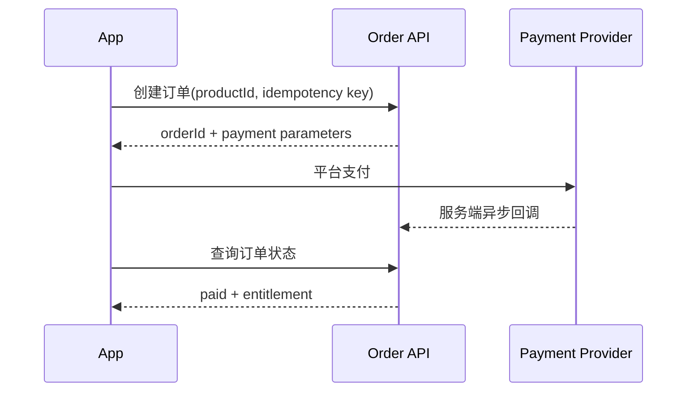

# Service 与 API 契约

客户端默认 `environment.useMocks=true` 以保持 Figma 原型演示；设置 `DEBAO_USE_MOCKS=false` 后，已接入页面通过统一 `ApiClient` 调用同级 `debao-server` 的真实本地 API。

## 通用约定

建议真实 API 使用：

```ts
interface ApiEnvelope<T> {
  data: T;
  requestId: string;
}

interface ApiFailure {
  code: string;
  message: string;
  requestId: string;
  details?: Record<string, unknown>;
}
```

鉴权使用 `Authorization: Bearer <access-token>`。客户端不得保存支付私钥或 AI provider key。`ApiClient` 默认 12 秒超时，并把错误转换成 `ApiError(status, code)`。

## AuthService

状态：默认 Mock；设置 `DEBAO_USE_MOCKS=false` 后使用真实本地 API，支持登录/刷新/资料/登出。

| 方法 | 建议端点 | 说明 |
|---|---|---|
| `getProfile()` | `GET /me` | 获取当前用户 |
| `updateProfile(profile)` | `PATCH /me` | 修改昵称和考试年份 |
| `logout()` | `POST /auth/logout` | 吊销 refresh token |

手机号必须由服务端脱敏。正式登录还需补短信验证码、token refresh、设备管理和注销账号流程。

## QuestionService

状态：默认 Mock；真实模式使用本地 API，草稿同时保留本地缓存以支持离线恢复。

```ts
interface QuestionSubmission {
  questionId: string;
  answers: string[];
}
```

| 方法 | 建议端点 | 说明 |
|---|---|---|
| `listSubjects()` | `GET /question-subjects` | 科目与题量 |
| `saveDraft()` | `PUT /question-drafts/:id` | 跨设备草稿 |
| `submit()` | `POST /question-submissions` | 服务端生成 submissionId |
| `listRecords()` | `GET /question-records` | 当前用户答题记录 |
| `listMistakes()` | `GET /mistakes` | 未解决错题与题目内容 |
| `resolveMistake(id)` | `DELETE /mistakes/:id` | 标记错题已复习 |
| `listFavorites()` | `GET /favorites` | 当前用户收藏题目 |
| `addFavorite/removeFavorite()` | `POST/DELETE /favorites` | 收藏增删与幂等 |

正式答题接口必须由服务端校验题目版本，不能相信客户端分值或正确答案。

## CourseService

状态：默认 Mock；真实模式使用本地 API。

| 方法 | 建议端点 | 说明 |
|---|---|---|
| `list()` | `GET /courses` | 当前用户课程 |
| `get(id)` | `GET /courses/:id` | 课程基础信息 |
| `entitlement(id)` | `GET /courses/:id/entitlement` | 当前用户课程权益 |
| `updateProgress(id, progress)` | `POST /courses/:id/progress` | 持久化学习进度 |

媒体 URL 应由服务端返回短时签名地址，并包含 DRM/清晰度/字幕元数据。

## OrderService 与 PaymentService

状态：默认 Mock；真实模式使用本地订单 API，支付由服务端适配器决定，当前 local 适配器不会产生真实扣款。

```ts
interface CreateOrderRequest {
  productId: string;
  clientRequestId: string;
}
```

建议流程：



客户端支付结果不能直接开通课程。服务端必须验签、幂等处理回调并发放权益。iOS 数字内容需先确认 App Store IAP 合规方案。

## AIService

状态：默认 Mock 流式文本；真实模式调用服务端 AI 适配器，正式 provider 仍需密钥和审核策略。

```ts
streamReply(prompt: string, onChunk: (chunk: string) => void): Promise<void>
```

建议真实端点为 `POST /ai/conversations/:id/messages`，响应 SSE 或 WebSocket 流。服务端负责模型密钥、内容审核、引用来源、限流和成本记录。客户端必须支持取消、重试和流中断恢复。

## MediaService

状态：默认 Mock；真实模式调用媒体授权适配器，当前未配置 CDN/DRM 时返回 `available: false`。

正式能力至少包含：播放授权、媒体 URL、直播房间 token、播放进度同步、离线清单、下载校验、DRM 和过期清理。

## NotificationService

状态：默认 Mock；真实模式调用服务端通知接口，三端系统权限仍需原生模块申请。

真实流程需区分 APNs、FCM/厂商通道和 Harmony Push。设备 token 只能提交给自有后端，后端记录平台、环境、用户和 token 更新时间。

## 统一错误码建议

| code | 含义 | 客户端处理 |
|---|---|---|
| `AUTH_REQUIRED` | 登录失效 | 清理 token 并进入登录流程 |
| `FORBIDDEN` | 无课程/题目权限 | 展示权益说明 |
| `VALIDATION_ERROR` | 参数错误 | 字段级提示 |
| `ORDER_STATE_CHANGED` | 订单状态变化 | 重新读取订单 |
| `PAYMENT_CANCELLED` | 用户取消支付 | 保留待支付订单 |
| `RATE_LIMITED` | AI/接口限流 | 显示等待时间 |
| `MEDIA_TOKEN_EXPIRED` | 媒体授权过期 | 静默刷新一次 |
| `INTERNAL_ERROR` | 服务端错误 | 可重试并记录 requestId |

## 本地产品化服务（已实现）

本仓库同级目录 `../debao-server` 提供本地 API。默认地址为 Android 模拟器可访问的 `http://10.0.2.2:4000/v1`；真机或 iOS 模拟器请设置 `DEBAO_API_BASE_URL` 为开发机局域网地址。

启动方式：

```powershell
cd ..\debao-server
Copy-Item .env.example .env
npm install
npm run dev
```

移动端仍默认 Mock。启动 Metro 前设置 `DEBAO_USE_MOCKS=false` 后，`AuthService`、`QuestionService`、`CourseService`、`OrderService`、`PaymentService`、`AIService`、`MediaService` 和 `NotificationService` 会切换到 `realServices.ts`，统一通过 `ApiClient` 请求本地服务。开发演示令牌为 `demo-token`，仅限本地使用。

当前 API 已覆盖健康检查、用户资料、会话刷新/登出、科目、答题草稿/提交/记录/错题/收藏、课程权益与进度、学习计划/任务/报告、订单创建/查询/支付、通知、AI 本地适配器、媒体授权占位、法条检索、论坛和运营接口。服务响应为 `{ data, requestId }`，错误为 `{ error: { code, message, requestId } }`。

PostgreSQL/Redis 的表结构与编排位于 `../debao-server/migrations/001_initial.sql` 和 `../debao-server/docker-compose.yml`。内存仓储是默认开发实现，接入正式数据库前必须完成迁移、连接池、备份和密钥配置。
