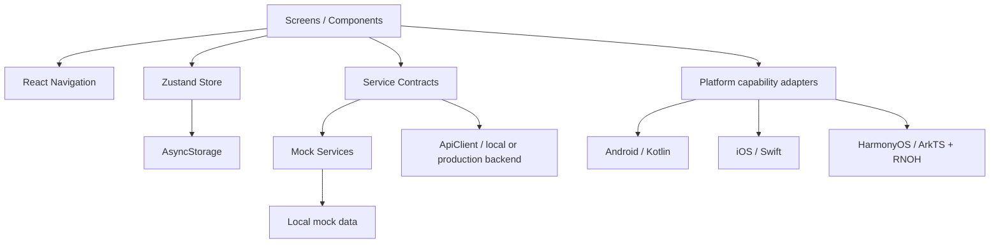
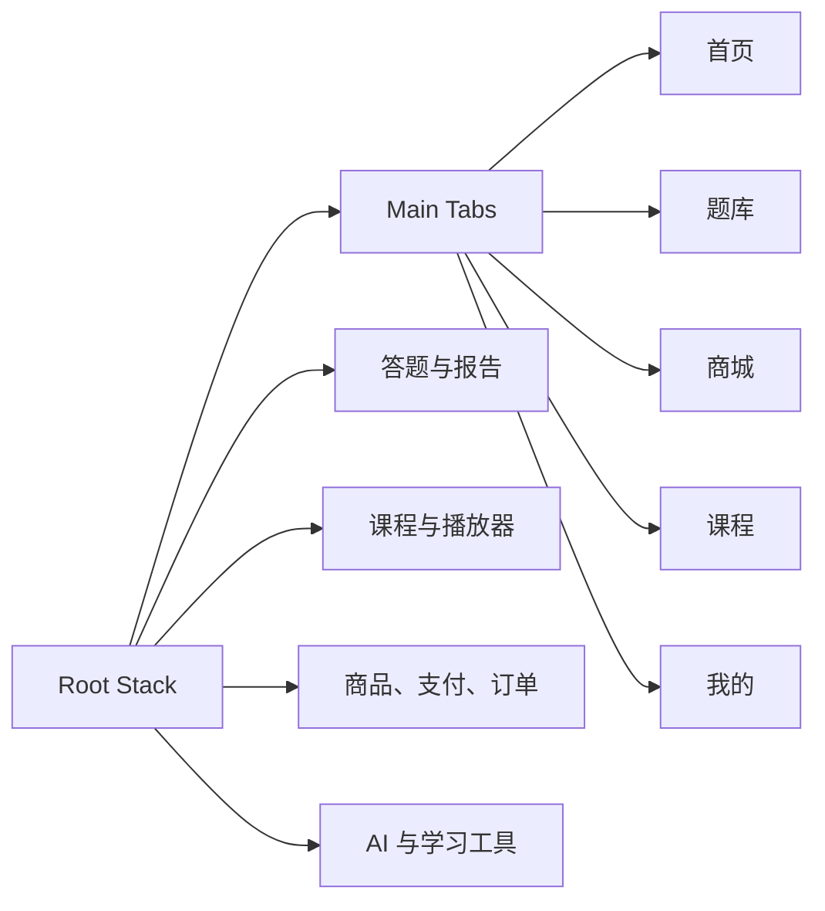
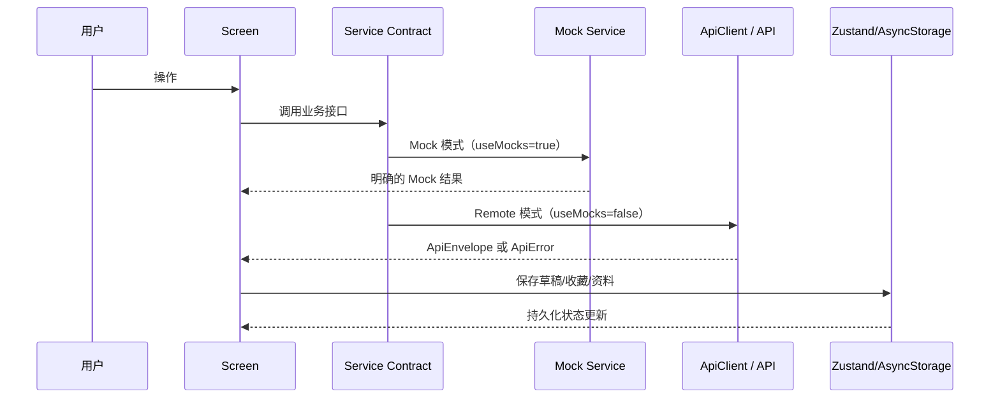

# 架构说明

## 总体结构

## 模块边界

- `screens`：组合 UI、触发用户意图，不直接访问平台原生 API。
- `components`：公共布局和交互组件，不依赖具体业务数据。
- `navigation`：集中声明路由、参数和五个主 Tab。
- `store`：保存跨页面客户端状态；仅持久化必要字段。
- `services/contracts.ts`：定义业务能力边界。
- `services/mockServices.ts`：第一阶段演示实现，所有异步结果都明确属于 Mock。
- `services/apiClient.ts`：真实模式的 HTTP 接入点，包含超时、鉴权刷新和标准错误映射；Mock 模式不发网络请求。
- `platform`：声明支付、推送、媒体、下载的平台实现状态。
- `data`：演示数据，不应被正式环境直接引用。
- `theme`：颜色、间距、圆角、阴影 Token。

## 导航

根导航使用 Native Stack，内部嵌套 Bottom Tabs。`RootStackParamList` 是参数的唯一类型来源。系统返回由 native-stack 管理，Android/Harmony 返回键会弹出当前栈顶页面。

## 数据流

页面始终只依赖 Service Contract；运行时按 `DEBAO_USE_MOCKS` 选择 Mock 或 API 实例，不允许页面直接拼接 URL 或保存访问令牌。

## 三端共享与专用代码

| 层 | Android | iOS | HarmonyOS |
|---|---|---|---|
| 页面/业务/状态 | 共享 TypeScript | 共享 TypeScript | 共享 TypeScript |
| RN 宿主 | Kotlin | Swift | ArkTS + C++ |
| Safe Area/Navigation/SVG/Storage | 标准 RN 包 | 标准 RN 包 | 对应 RNOH 端口 HAR |
| 支付/推送/媒体/下载 | 待 Kotlin adapter | 待 Swift adapter | 待 ArkTS adapter |

## 错误处理

- `ApiClient` 将 HTTP、超时和网络错误转换为 `ApiError`。
- `AppErrorBoundary` 捕获未处理的 React render 错误。
- Service 调用的业务错误应由页面显示 inline error 或可重试状态。
- 当前尚未选择线上监控供应商，`componentDidCatch` 只写本地日志；选择供应商后通过平台 adapter 接入。

## Mock 边界

Mock 仍包括原型视觉所需的用户资料、题目、订单、学习工具、通知和固定 AI 回答。`DEBAO_USE_MOCKS=false` 时，登录、题库/报告、课程/权益/进度、学习计划/报告、订单、论坛、通知列表/已读、法条、错题/收藏和基础批改已通过 `realServices.ts` 读取本地 API；请求失败不会静默回退 fixture。媒体页仍只有授权探测和 UI 状态机，支付不会扣款，AI 生产 Provider、推送权限和附件上传仍未接入。
