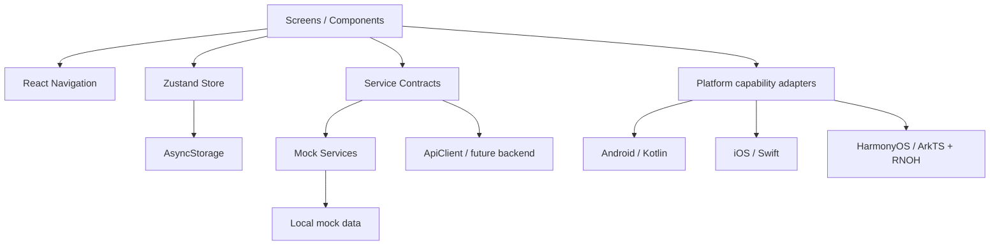
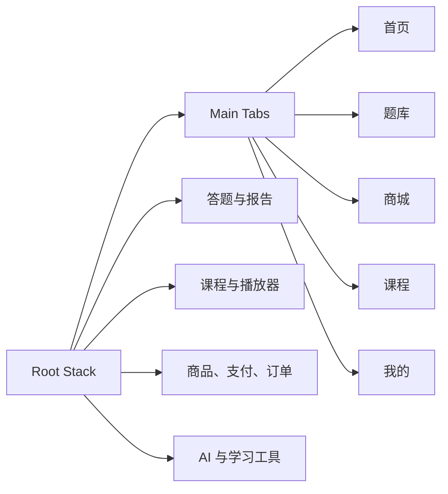
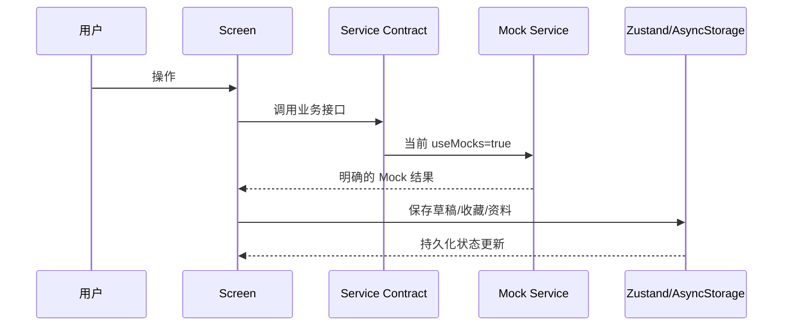

# 架构说明

## 总体结构

## 模块边界

- `screens`：组合 UI、触发用户意图，不直接访问平台原生 API。
- `components`：公共布局和交互组件，不依赖具体业务数据。
- `navigation`：集中声明路由、参数和五个主 Tab。
- `store`：保存跨页面客户端状态；仅持久化必要字段。
- `services/contracts.ts`：定义业务能力边界。
- `services/mockServices.ts`：第一阶段演示实现，所有异步结果都明确属于 Mock。
- `services/apiClient.ts`：未来真实 HTTP 接入点，包含超时和标准错误映射。
- `platform`：声明支付、推送、媒体、下载的平台实现状态。
- `data`：演示数据，不应被正式环境直接引用。
- `theme`：颜色、间距、圆角、阴影 Token。

## 导航

根导航使用 Native Stack，内部嵌套 Bottom Tabs。`RootStackParamList` 是参数的唯一类型来源。系统返回由 native-stack 管理，Android/Harmony 返回键会弹出当前栈顶页面。

## 数据流

正式后端接入时替换 Service 实例，不允许让页面直接拼接 URL 或保存访问令牌。

## 三端共享与专用代码

| 层 | Android | iOS | HarmonyOS |
|---|---|---|---|
| 页面/业务/状态 | 共享 TypeScript | 共享 TypeScript | 共享 TypeScript |
| RN 宿主 | Kotlin | Swift | ArkTS + C++ |
| Safe Area/Navigation/SVG/Storage | 标准 RN 包 | 标准 RN 包 | 对应 RNOH 端口 HAR |
| 支付/推送/媒体/下载 | 待 Kotlin adapter | 待 Swift adapter | 待 ArkTS adapter |

## 错误处理

- `ApiClient` 将 HTTP、超时和网络错误转换为 `ApiError`。
- `AppErrorBoundary` 捕获未处理的 React render 错误。
- Service 调用的业务错误应由页面显示 inline error 或可重试状态。
- 当前尚未选择线上监控供应商，`componentDidCatch` 只写本地日志；选择供应商后通过平台 adapter 接入。

## Mock 边界

Mock 包括用户资料、题库提交、订单、支付、AI 流式文本、媒体准备、通知。媒体页只有 UI 和状态机，没有真实播放；支付不会扣款；AI 不调用外部模型；通知不请求系统权限。
