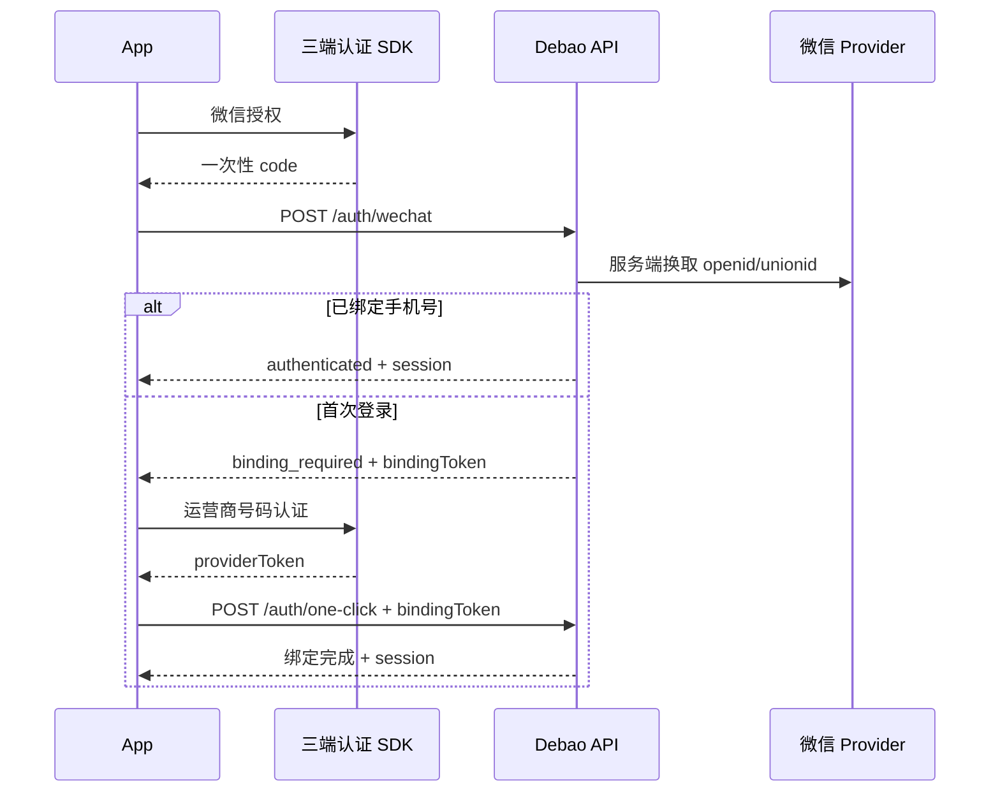

# 登录与账号绑定接入

## 已实现流程

客户端真实模式启动时先恢复 refresh token。恢复失败或本地没有会话时显示登录页，提供：

1. 运营商手机号一键登录。
2. 微信登录；首次微信授权必须绑定手机号。
3. 手机短信验证码登录和微信绑定的回退入口。

微信授权只把一次性 `code` 交给自有服务端；微信 `AppSecret`、运营商密钥、短信密钥不得进入客户端。绑定票据有效期为 10 分钟，使用后立即失效。微信身份和手机号均有唯一约束，冲突返回 `IDENTITY_ALREADY_BOUND`。

短信挑战由服务端持久化，5 分钟过期、最多 5 次失败尝试且成功后立即消费。相同手机号和用途 60 秒内不可重复发送；手机号、请求 IP 和设备分别有小时级上限。生产网关需要保证 `remoteAddress` 是可信代理处理后的真实来源地址。



## 客户端运行模式

| 配置 | 用途 |
|---|---|
| `DEBAO_USE_MOCKS=true` | 保持 Figma 原型演示，直接进入主应用 |
| `DEBAO_USE_MOCKS=false` | 启用真实登录门禁和本地 API |
| `DEBAO_AUTH_PROVIDER_MODE=local` | 开发模式使用明确标记的本地微信 code 和运营商 token |
| `DEBAO_AUTH_PROVIDER_MODE=native` | 调用三端 `DebaoAuthProvider` 原生模块 |

开发构建默认使用 `local`，发布构建默认使用 `native`。发布包如果没有原生 SDK，按钮会禁用并保留短信登录，不会伪造成功。

## 原生桥接契约

Android、iOS、HarmonyOS 都向 React Native 注册同名模块 `DebaoAuthProvider`：

```ts
interface DebaoAuthProvider {
  getCapabilities(): Promise<{wechat: boolean; oneClick: boolean}>;
  authorizeWechat(): Promise<{code: string}>;
  getCarrierToken(): Promise<{providerToken: string; maskedPhone?: string}>;
}
```

原生层只返回供应商的一次性凭证。客户端不得解析运营商 token，也不得直接调用微信 `code2Session`。

## 登录后的账号安全

`账号与安全` 页面已接入以下服务端闭环：

- 当前手机号和新手机号分别验证后完成换绑，任一验证码失败时不会消费另一边的有效验证码。
- 微信绑定和解绑都要求当前手机号二次验证，第三方身份冲突返回 `IDENTITY_ALREADY_BOUND`。
- 登录成功自动登记设备；移除设备会同时吊销该设备的 Access/Refresh 会话和 Redis 缓存。
- Refresh Token 每次刷新后轮换，旧 token 再次使用返回 `AUTH_REQUIRED`。
- 注销申请需短信验证，进入 7 天冷静期；冷静期内可撤销，到期后匿名化资料、解绑身份、移除设备并吊销全部会话。
- 资料支持头像颜色和已上传 `avatarUrl` 持久化。三端图片选择统一预留 `DebaoProfileMedia.pickAvatar()`，正式文件上传仍需对象存储配置。

账号安全端点、请求体和错误码以 `debao-server/openapi.yaml` 为准。

## Android

- 微信开放平台应用包名必须为 `com.debao.app`，同时登记发布签名摘要。
- 在 `MainApplication` 注册实现 `DebaoAuthProvider` 的 React Package。
- 在微信回调 Activity 中把授权结果恢复到待处理 Promise。
- 号码认证 SDK 必须覆盖当前 `minSdkVersion`，并在隐私同意后初始化。
- Release 构建不得继续使用 debug keystore。

## iOS

- 微信开放平台 Bundle ID 必须与 Xcode 工程一致。
- 配置 URL Scheme、Universal Link，并从 `AppDelegate` 转发微信回调。
- 号码认证 SDK 通过 CocoaPods 或供应商 XCFramework 接入。
- 原生授权页的隐私文案、返回按钮和品牌元素需要按供应商规范配置。
- 上架前按当期 App Store 审核规则确认是否同时提供 Apple 登录。

## HarmonyOS

- 在 DevEco 工程中配置应用包名、签名和微信 HarmonyOS SDK。
- 使用 RNOH Package 暴露 `DebaoAuthProvider` Turbo/Native Module。
- 号码认证供应商必须明确支持当前 HarmonyOS API Level。
- 通过 `EntryAbility` 处理授权回调和 Ability 生命周期恢复。

## 服务端 Provider 协议

服务端支持 `local`、`http`、`unconfigured` 三种模式。

```text
POST {WECHAT_AUTH_PROVIDER_URL}/auth/wechat/exchange
Authorization: Bearer {WECHAT_AUTH_PROVIDER_KEY}
Body: { "code": "..." }
Response: { "providerUserId": "openid", "unionId": "unionid", "nickname": "..." }

POST {CARRIER_AUTH_PROVIDER_URL}/auth/carrier/verify
Authorization: Bearer {CARRIER_AUTH_PROVIDER_KEY}
Body: { "providerToken": "..." }
Response: { "phone": "13800138000", "carrier": "CMCC" }

POST {SMS_PROVIDER_URL}/sms/send-code
POST {SMS_PROVIDER_URL}/sms/verify-code
```

生产环境必须把 `WECHAT_AUTH_ADAPTER` 和 `CARRIER_AUTH_ADAPTER` 设为 `http`；默认 `unconfigured`，不会退回本地认证。

## 本地验收

本地 Provider 使用：

- 微信 code：以 `local-wechat-` 开头。
- 一键登录 token：`local-one-click:<11位手机号>`。
- 短信验证码：`123456`。

运行 `debao-server npm test` 会覆盖验证码消费/频控/尝试次数、Refresh Token 轮换、微信首次绑定、手机号换绑、解绑二次验证、设备会话吊销和注销状态机。运行 `debao-mobile pnpm test` 会覆盖协议确认、登录、账号安全表单、设备移除和注销撤销。

## 外部验收材料

- 微信开放平台 AppID/AppSecret、三端应用登记信息和回调配置。
- 号码认证供应商应用 ID、密钥、三端 SDK 和隐私授权页规范。
- 短信签名、模板、频控和验证码校验接口。
- Android/iOS/HarmonyOS 发布签名与至少一台对应真机。
