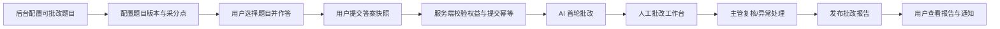

# 得宝主观题批改系统设计

更新时间：2026-08-31

## 1. 业务定义

批改不是“用户上传任意文件后进入一个普通队列”，而是一条由题目内容驱动的服务链：



AI 只负责首轮分析和建议，不直接决定最终成绩；最终报告必须由人工批改结果发布。没有配置真实 OpenAI provider 时，只展示明确不可用状态，不伪造 AI 结果。

## 2. 参与角色

| 角色 | 主要职责 | 可见范围 |
|---|---|---|
| 学员 | 选择可批改题、作答、提交、查看进度和报告 | 只能看自己的题目、答案、状态和最终报告 |
| 兼职批改老师 | 领取分配任务、按采分点评分、填写评语、提交复核 | 只能看分配给自己的任务；不显示 OpenAI key、模型密钥、成本配置和其他用户完整隐私 |
| 批改主管 | 分派、改派、处理超时/驳回/申诉、抽检人工结果 | 可看批改任务、AI 建议、人工结果和团队统计 |
| 内容管理员 | 创建题目、发布题目、维护批改依据和采分点 | 可维护题目及其版本，不可直接改用户最终成绩 |
| 系统管理员 | 配置 AI provider、模型、限额、权限和审计 | 可配置服务端模型，但密钥只存在服务端环境或密钥管理系统 |

兼职老师账号属于独立的批改人员身份体系，不能复用普通学员账号，也不能把“后台超级管理员”直接发给兼职老师。

## 3. 后台题目配置

只有标记为“支持批改”且已发布的题目，才会出现在用户端批改题库。

### 3.1 题目字段

- 题目 ID、题目版本、科目、年份、标题、案情、问题列表。
- `gradingEnabled`：是否支持批改。
- 总分、每个小问分值、建议答题时长、允许的答案类型（文本/图片/PDF）。
- 批改说明：给人工老师看的答题方向、常见错误、法律依据和注意事项。
- 发布状态：`draft -> review -> published -> disabled -> archived`。
- 已被提交引用的题目版本不可覆盖修改，只能创建新版本。

### 3.2 采分点字段

每个小问都必须配置可独立核验的采分点：

- 采分点 ID、名称、分值、排序。
- 得分条件：必须出现的法律结论、规范依据、构成要件、事实涵摄或程序结论。
- 参考法条和关键词，仅作为批改依据，不作为简单字符串匹配规则。
- 部分得分规则、扣分规则、满分上限和互斥关系。
- AI 提示：允许 AI 关注的证据类型和风险提示。
- 版本状态和变更原因。

后台发布题目前必须通过“采分点完整性校验”：每个小问有分值、所有采分点分值之和不超过小问分值、题目总分等于小问分值之和。

## 4. 学员端流程

1. 用户在“批改服务”进入可批改题库，按科目、年份、难度、剩余次数筛选。
2. 用户打开题目，查看案情和小问，在原有主观题作答页完成文本答案；需要时上传图片/PDF。
3. 点击“提交批改”时，服务端重新读取题目版本、校验答案格式、附件安全和批改权益。
4. 服务端生成不可变的提交快照：题目版本、每个小问答案、附件引用、提交时间和权益扣减记录。
5. 用户可查看状态：等待 AI、AI 批改中、等待人工、人工批改中、已完成、需要补交、异常/失败。
6. 人工报告发布后，向用户发送通知；用户可查看总分、分项得分、采分点命中情况、老师评语、改进建议和报告文件。

同一题目版本的同一份答案快照使用幂等键，重复点击不能重复扣次数或生成多份任务。重新批改必须生成新的提交版本，并按产品规则扣减或返还次数。

## 5. 批改状态机

```text
submitted
  -> ai_queued
  -> ai_processing
  -> ai_completed
  -> manual_queued
  -> manual_claimed
  -> manual_submitted
  -> supervisor_review (可选)
  -> published
```

异常分支：`ai_failed`（可重试）、`manual_returned`（补交/重派）、`manual_expired`（释放并升级）、`appealed`（独立复核）、`cancelled`（符合规则时取消）。最终报告只能从人工提交或主管复核发布，不能静默覆盖历史结果。

## 6. AI 首轮批改

服务端将题目版本、案情、小问、批改依据、采分点、参考法条、用户答案及安全检查后的附件 OCR 文本提交给 AI 网关。AI 必须返回结构化 JSON：

```json
{
  "questionVersion": "qv-2026-001",
  "subQuestions": [{
    "subQuestionId": "q1-1",
    "suggestedScore": 8,
    "confidence": 0.82,
    "points": [{"pointId": "p1", "status": "hit", "evidence": "答案原文片段"}],
    "risks": [],
    "suggestedFeedback": "建议补充规范依据并完成事实涵摄"
  }],
  "totalSuggestedScore": 8,
  "needsHumanAttention": false
}
```

服务端校验 JSON schema、分数上限、题目版本和采分点 ID。AI 结果仅供人工工作台参考，用户端不展示“AI 已判定”。模型名称、系统提示词、provider URL、API key、token 用量和成本只对系统管理员及审计服务可见。

模型可配置为 GPT 系列的不同档位，例如低成本首轮模型和高质量复核模型；配置位于服务端环境或密钥管理系统，兼职老师只能看到 AI 建议状态。

## 7. 兼职老师批改工作台

批改工作台是独立登录入口，不和运营后台共用可见菜单。

- 登录：批改人员账号、密码，可选短信/MFA；支持停用、重置、设备会话和强制退出。
- 权限：按角色和科目范围授权，只能访问已分配任务和必要的用户标识。
- 任务：待领取、我的任务、即将超时、已提交、已退回；领取使用服务端原子锁。
- 详情：题目、题目版本、案情、用户答案/附件、采分点、AI 建议和评分表并排展示。
- 提交：逐采分点评分、总评、错误类型、改进建议；修改 AI 建议必须填写原因。
- 异常：材料不清、题目配置错误、疑似作弊、超出能力范围，必须选择退回原因。
- 统计：今日完成量、每小时完成量、平均处理时长、退回率、复核通过率。

兼职老师不能查看 OpenAI key、模型密钥、完整提示词、成本配置或其他用户资料。

## 8. 用户批改报告

报告由服务端根据人工最终结果生成，包含题目版本、提交/完成时间、总分、每小问得分、每个采分点命中/缺失/部分得分、老师总评、规范建议、薄弱能力标签、报告文件、报告版本和申诉入口。用户只能看到最终人工结果和必要解释，不展示内部 AI 草稿、供应商信息或批改人员隐私。

## 9. 数据模型建议

建议新增或拆分：`gradable_questions`、`grading_rubrics`、`grading_rubric_points`、`grading_submissions`、`grading_submission_answers`、`grading_ai_runs`、`grading_assignments`、`grading_reviews`、`grading_reports`、`grader_accounts`、`grader_sessions`、`grading_events`、`grading_hourly_metrics`。

原有 `grading_submissions` 表只能作为迁移起点，不能继续把 `score` 和 `feedback` 作为唯一结果字段；必须增加题目版本、AI 运行、任务分配、人工复核和报告实体。

## 10. API 分层

### 学员 API

- `GET /v1/grading/questions`
- `GET /v1/grading/questions/:id`
- `POST /v1/grading/submissions`（支持 `Idempotency-Key`）
- `GET /v1/grading/submissions`
- `GET /v1/grading/submissions/:id`
- `GET /v1/grading/submissions/:id/report`
- `POST /v1/grading/submissions/:id/appeals`

### 批改人员 API

- `POST /v1/grader/auth/login`、`POST /v1/grader/auth/logout`、`GET /v1/grader/me`
- `GET /v1/grader/tasks`
- `POST /v1/grader/tasks/:id/claim`
- `GET /v1/grader/tasks/:id`
- `POST /v1/grader/tasks/:id/return`
- `POST /v1/grader/tasks/:id/review`
- `GET /v1/grader/stats`

### 运营/系统管理员 API

- `GET/PATCH /v1/admin/content/questions/:id/grading-rubric`
- `GET /v1/admin/grading`、`GET /v1/admin/grading/:id`
- `POST /v1/admin/grading/:id/reassign`、`POST /v1/admin/grading/:id/escalate`
- `GET /v1/admin/grading/stats`
- `GET/PATCH /v1/admin/ai/providers`（密钥不通过页面回传）

## 11. 统计口径

从不可变 `grading_events` 聚合，统一使用服务端时区：每小时/每日/每人领取与完成量、平均和中位处理时长、SLA、退回/超时/申诉率、AI 建议与人工最终分差、采分点一致率、AI 调用次数、token、成本和失败率。AI 成本和模型数据不暴露给兼职老师。

## 12. 安全与合规

- 用户答案和附件按最小权限访问，下载 URL 使用短时签名。
- 文件校验类型、大小、病毒和内容安全；OCR 文本和原文件分开授权。
- 批改人员默认只看到必要用户标识，不显示完整手机号和无关资料。
- Provider key、系统提示词和模型配置只从服务端环境/密钥系统读取。
- 领取、评分、改分、退回、发布、申诉处理和配置变更全部写入审计日志。
- 报告发布后不可覆盖；改分必须产生新复核版本并记录原因。

## 13. Goal 实施顺序

1. `GRADE-00`：数据模型、状态机、错误码、幂等和迁移。
2. `GRADE-01`：后台支持批改开关、批改依据、采分点编辑和版本发布。
3. `GRADE-02`：用户可批改题库、作答快照、附件上传、权益扣减和提交状态。
4. `GRADE-03`：AI 网关、GPT 模型配置、结构化输出校验、重试和成本记录。
5. `GRADE-04`：独立批改人员登录、任务领取、评分工作台、退回和超时升级。
6. `GRADE-05`：人工结果发布、报告生成、用户查看/下载、通知和申诉。
7. `GRADE-06`：小时/日统计、团队看板、AI/人工差异、审计和权限验收。

## 14. 验收标准

- 后台发布一个带完整采分点的题目后，用户端才能看到并提交该题。
- 用户提交生成不可变题目版本和答案快照，重复提交不重复扣次。
- AI 首轮严格依据该题目版本的采分点输出结构化建议；provider 未配置时明确失败。
- 兼职老师登录后才能领取任务，只能看到授权任务和必要信息。
- 两名老师并发领取同一任务时只有一人成功；老师不能查看模型密钥。
- 人工结果发布后，用户能看到按小问/采分点展开的报告和评语。
- 每小时、每日完成量与事件明细一致；改分、退回、发布和申诉均可审计。

