# 测试与验证

## 自动检查

```powershell
pnpm typecheck
pnpm lint
pnpm test
pnpm check
```

当前结果（2026-08-28）：

| 检查 | 结果 | 范围 |
|---|---|---|
| TypeScript | 通过 | App TS/TSX 严格检查 |
| ESLint | 通过 | 全工程 JS/TS/TSX，无 warning |
| Jest | 通过 | 7 suites / 8 tests |
| Service unit | 通过 | Mock 支付、AI 流式输出 |
| Component | 通过 | AppButton 文案/按压；题库主客观题页内切换且不误导航 |

Harmony `hvigorfile.ts` 不由应用 `tsc` 检查，其类型来自 DevEco/ohpm；ArkTS 与 Hvigor 必须由 Harmony 原生构建验证。

## Bundle 验证

Android：

```powershell
New-Item -ItemType Directory -Force .cache\android-assets | Out-Null
pnpm exec react-native bundle --platform android --dev false --minify true --entry-file index.js --bundle-output .cache\index.android.bundle --assets-dest .cache\android-assets
```

iOS：

```powershell
New-Item -ItemType Directory -Force .cache\ios-assets | Out-Null
pnpm exec react-native bundle --platform ios --dev false --minify true --entry-file index.js --bundle-output .cache\main.jsbundle --assets-dest .cache\ios-assets
```

HarmonyOS：

```powershell
pnpm harmony:link
pnpm harmony:bundle
```

三项均已通过。Harmony 日志确认 4 个标准包被重定向到 RNOH 端口，并生成 Hermes HBC。

## 原生构建与真机

### Android

已在 `Debao_API_36`（Pixel 6、Android API 36、Google APIs x86_64）完成 Debug APK 构建、安装和冷启动。应用进程保持前台，logcat 无 JavaScript/Android Runtime 崩溃，首页视觉检查通过。

首页已按 Figma Make `Home.tsx` 完成 1:1 重做。原型基准：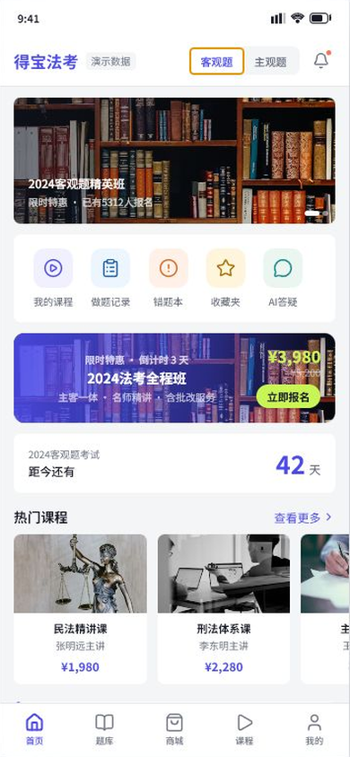 

客观题状态：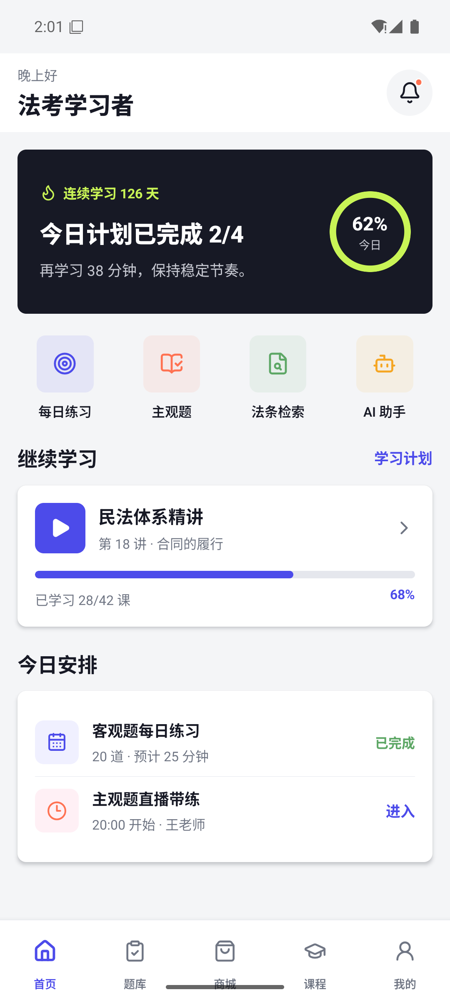

主观题状态：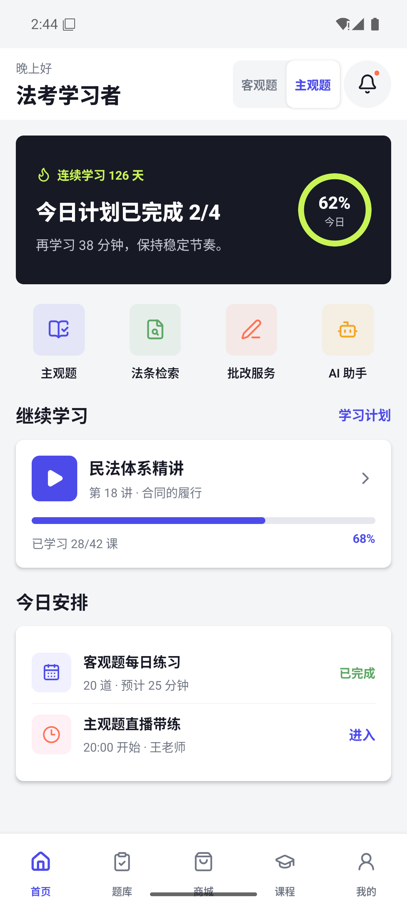

右上角分段控件通过 UIAutomator 验证：默认“客观题”的 `selected` 为 true；点击“主观题”后选中态切换，并显示“课程、法条检索、做题记录、收藏夹、批改、AI答疑”六个原型入口。第二张 Banner、第二条公告、公告关闭、社区热帖滚动内容也已验证；切换后应用进程保持存活且无崩溃日志。补充截图见 `android-home-banner-two.png` 和 `android-home-community.png`。

题库页 1:1 原型回归已完成：默认客观题态显示“历年真题、章节练习、民法总则”，主观题态显示“分科真题、历年整卷、2023年主观题”，年份弹层显示“选择年份、2023年、2018年”。三态均在 API 36 模拟器截图确认。

客观题态：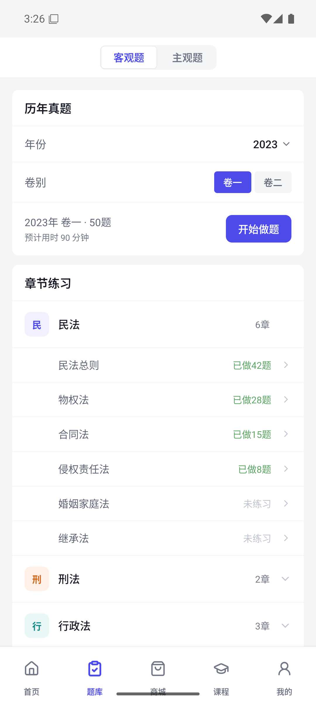

主观题态：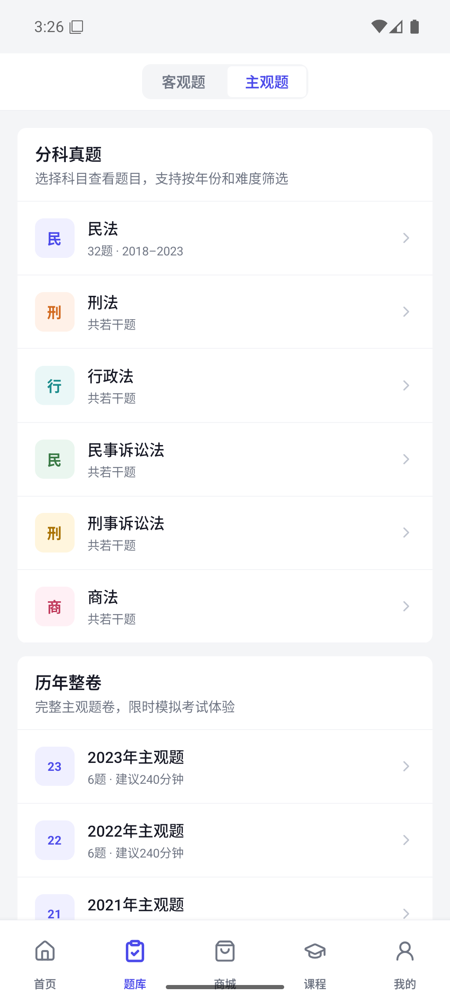

年份弹层：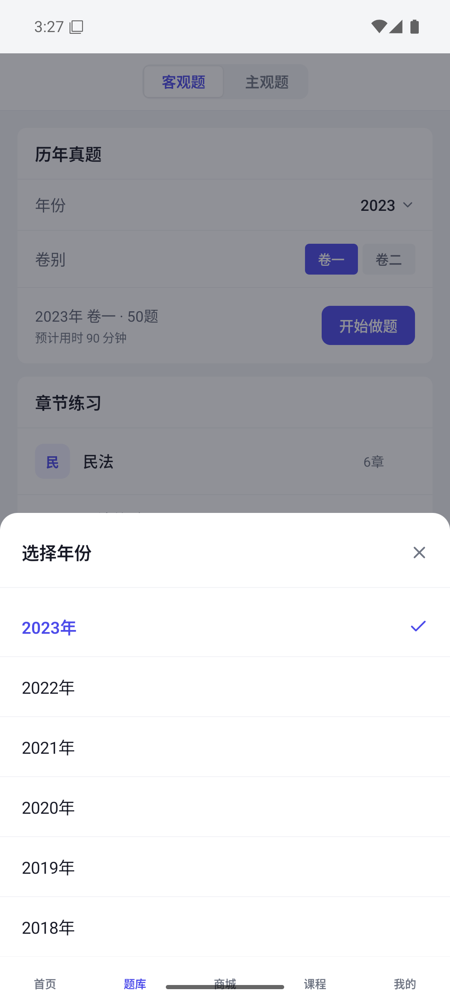

商城页 1:1 回归已完成：标题、搜索框、分类 Tab、课程类型筛选和 6 个商品行与原型结构一致；UIAutomator 验证筛选组合和空态，Jest 验证商品详情参数。

默认态：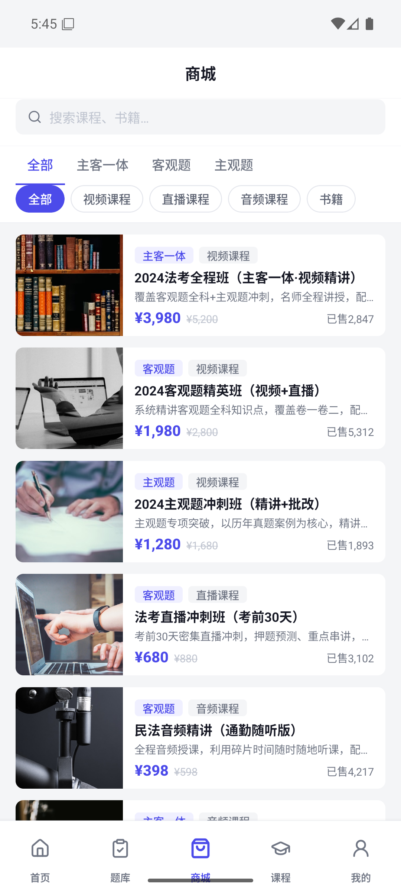

空态：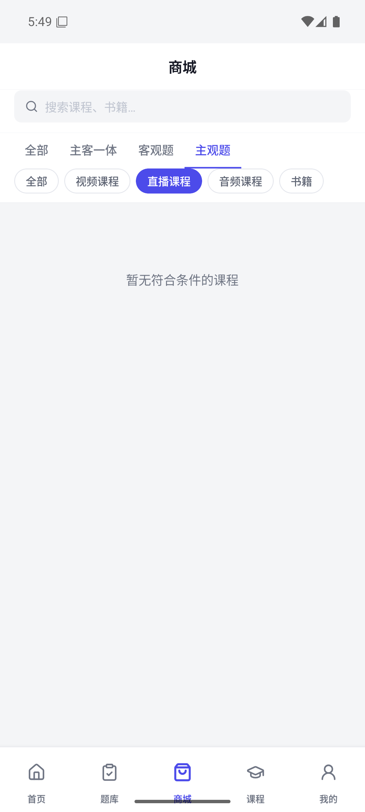

课程页 1:1 回归已完成：学习日历与全部课程两态、当前课程、周日历、快捷筛选、时间线、动态周切换、月份选择、待补课调整、加入学习安排及录播/专项/音频/直播分组均与原型结构一致。Jest 覆盖页面状态和类型化导航；UIAutomator 确认下一周变为 8月31日到 9月6日。

原型基准：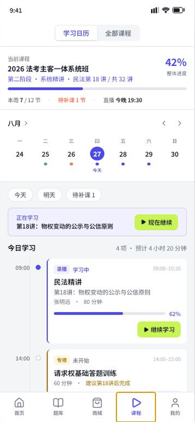 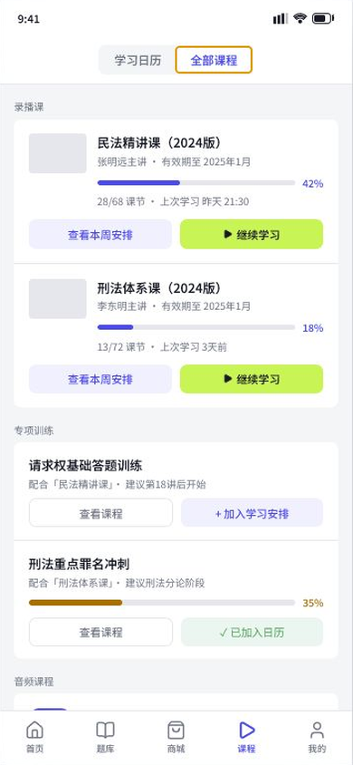

Android 正常态：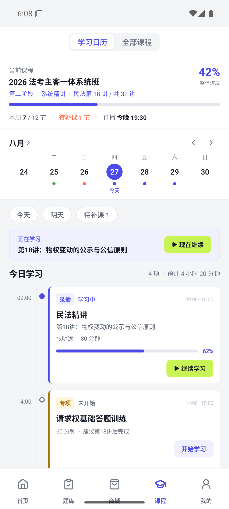 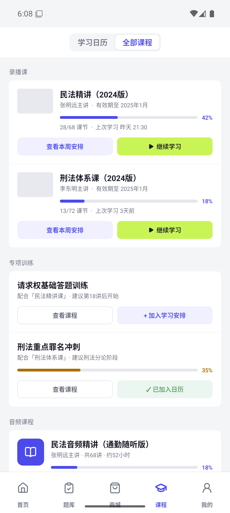

Android 弹层态：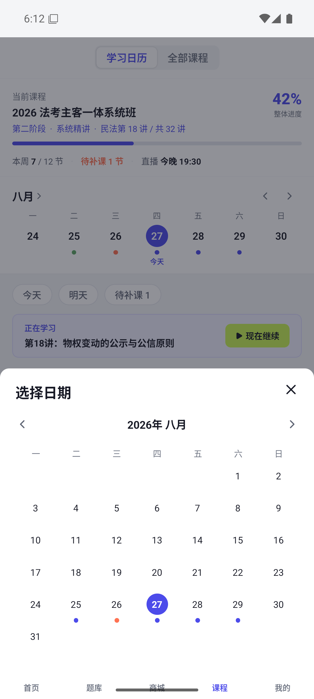 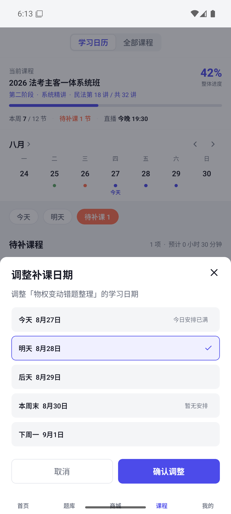 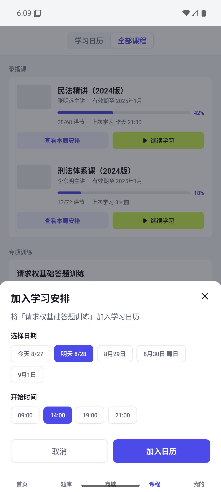

“我的”页 1:1 回归已完成：账号、继续学习、已开课程/本周学习/当前进度、本周重点、学习与内容、课程与服务和应用管理均与原型结构一致。UIAutomator 验证全部菜单节点，Jest 验证 14 个页面操作对应的 12 类路由目标。

原型基准：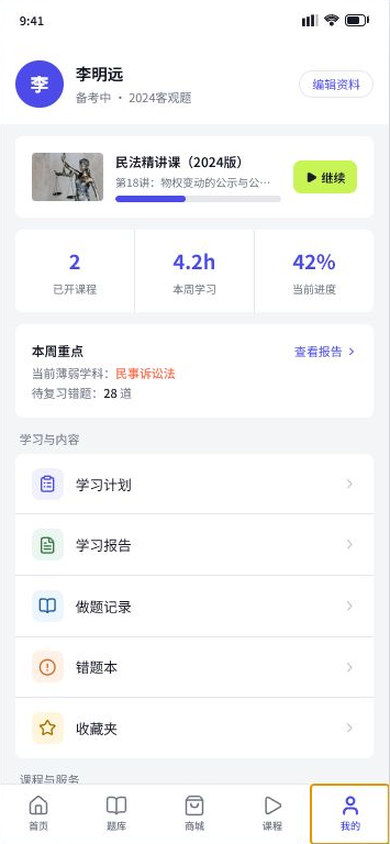

Android 首屏与滚动态：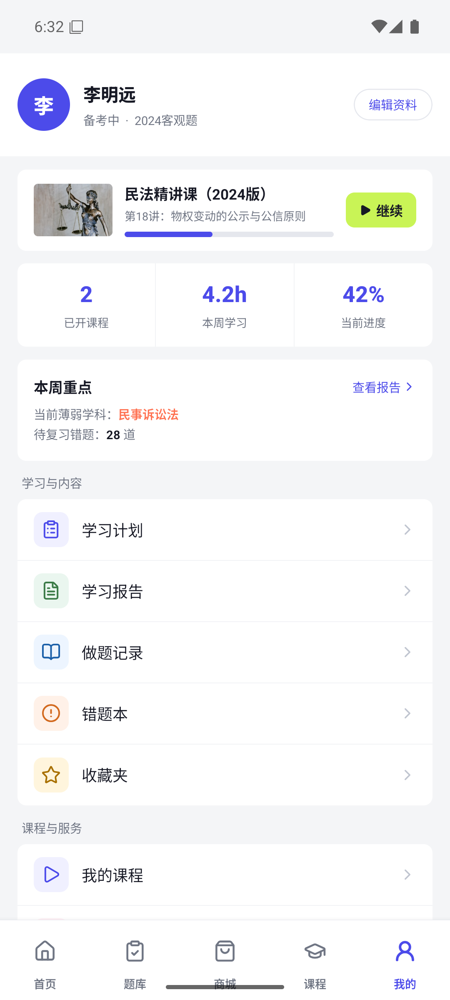 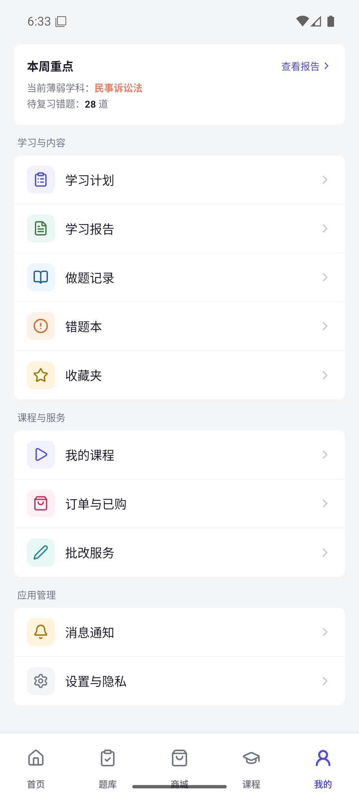

五 Tab 烟雾测试已通过：依次点击题库、商城、课程、我的和首页，UIAutomator 分别匹配到“客观题”“精选课程”“我的课程”“得宝 AI 学习助手”“法考学习者”，测试后应用进程保持存活且无崩溃日志。

APK：`android/app/build/outputs/apk/debug/app-debug.apk`。

尚需验证：系统返回、键盘遮挡、支付 Mock、AI 流式状态、旋转和小屏设备。当前结果是模拟器验证，不等同于 Android 真机兼容性验收。

### iOS

当前 Windows 未执行原生构建。macOS 需要验证 Pod install、Debug build、Safe Area、键盘、系统返回手势和 iPhone SE/标准/Max 三种尺寸。

### HarmonyOS

当前缺少 DevEco CLI/SDK。安装后需验证 HAP build、四个 HAR link、ArkTS appKey、返回键、Safe Area、AsyncStorage 和 Lucide SVG 渲染。

## 端到端策略

选择支持 React Native 和三端设备驱动的工具前，不引入只支持 Android/iOS 的 E2E 依赖。计划分层：

1. Service contract test：不依赖设备。
2. Component test：状态和无障碍属性。
3. Android/iOS：在 CI 使用设备或模拟器执行主流程。
4. HarmonyOS：通过 hdc/DevEco 测试任务执行同一验收场景。

核心 E2E 场景：

- 五个 Tab 逐一打开且状态不丢失。
- 客观题选项、解析、报告和返回题库。
- 主观题输入、保存草稿、重启恢复、Mock 提交。
- 商品创建 Mock 订单、支付提示、订单详情。
- 课程进入视频/音频/直播并显示真实能力未接入。
- AI 文本逐段生成，发送中禁止重复提交。
- 修改用户资料并重启恢复。

## 未覆盖范围

真实鉴权、后端错误码、支付 SDK、真实媒体、直播、下载、推送、弱网、升级迁移、性能、崩溃恢复和无障碍读屏尚未接入或验证。每项需要在对应真实 Service/adapter 实现时补测试，不能沿用 Mock 测试作为上线证据。
